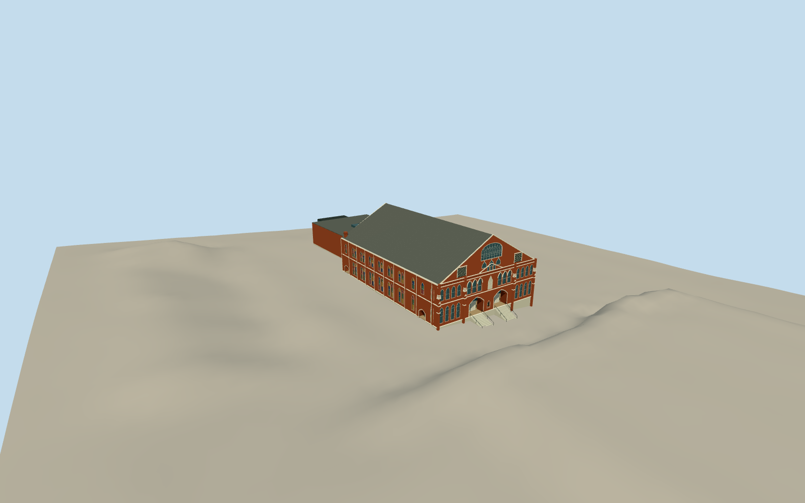

# Ryman Auditorium

Surviving red-brick Gothic auditorium on sloping limestone base, steep dark gabled roof with two rear chimneys, ornate white-banded front with twin deeply recessed door portals/stairs, grouped lancets/offset buttresses/Union Gospel panel and large traceried gable light. Long side paired stained-glass bays, real recessed side stair portals and downpipes. Separately bounded modern rear wing with copper screen/open covered entrance, concrete steps and lower glazed pavilion. No neighboring towers or honky-tonks/interior.

Authoring state: **review-in-qa.json**. Current completion evidence is in [qa.json](qa.json) and the [local 100 ledger](../../../../qualla-structures/batches/PROGRESS.md).

- [Ryman Auditorium](https://qualla.com/ryman-auditorium/)

Current2007–2023 historic exterior combined with built2015rear wing/pavilion. Source photographs/text inform exterior rather than a survey; fine tracery/trim/window colors/hidden faces and unmeasured roof heights are original proportional estimates.

Native generalized historic plan34.5mfront/50.03msides retained; primary120ft/178ft nominal includes offsets/vestibule. Exact plan chainages and facade bay spacing remain approximate, no forced stretching.

Independent original Terrarium heights remain unchanged.3m review grid/source3.857mpixels are not threshold surveys. Dry reference137.5265m/floor.9m/fixed-4m foundation and stair end levels are bounded authoring pose; host terrain compatibility remains dataset-dependent.

Copper-screen hole pitch is coarsened geometrically at close/street; district uses geometric dark marks. Modern rooflight/service envelope and rear hidden facades are approximate native-plan masses subordinate to historic roof. Rear gable light is boarded per NPS description rather than duplicating front tracery.

No original lost parapet crockets, actual signage/artwork/textures, interiors/pews/stage, neighboring towers/honky-tonks, trees/crowds/vehicles or photo pixels embedded. Shared metric material graphs and original palette colors only.

Build: `node packages/worldgen/scripts/generate-authored-places.mjs --ids=ryman_auditorium`. Add `--check` to verify exact regeneration. 63963 triangles; 7 materials; no embedded photographs.
