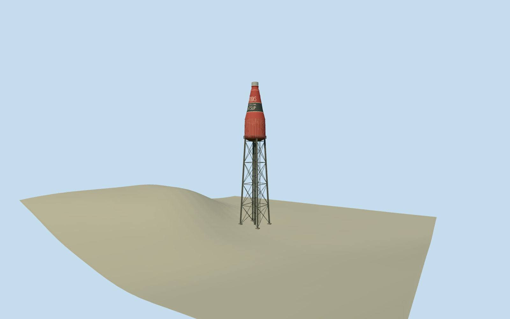

# Brooks Catsup Bottle water tower

Collinsville’s 1949 steel catsup-bottle water tower, with its red painted tank, white cap and steel cross-bracing.

Authoring state: **review-in-qa.json**. Current completion evidence is in [qa.json](qa.json) and the [completion ledger](../../../../qualla-structures/batches/qualla-004.PROGRESS.md).

- [Brooks Catsup Bottle water tower](https://qualla.com/brooks-catsup-bottle-water-tower/)

Official vertical and diameter dimensions control the structure. The precise leg spread, lattice and label letterforms are approximated from the published original.

Build: `node content/worldgen/source/places/dn/dnb/brooks_catsup_bottle_water_tower/models/generate-brooks-catsup-bottle-water-tower.mjs`. Add `--check` to verify exact regeneration. 13282 triangles; 4 materials; no embedded photographs.
