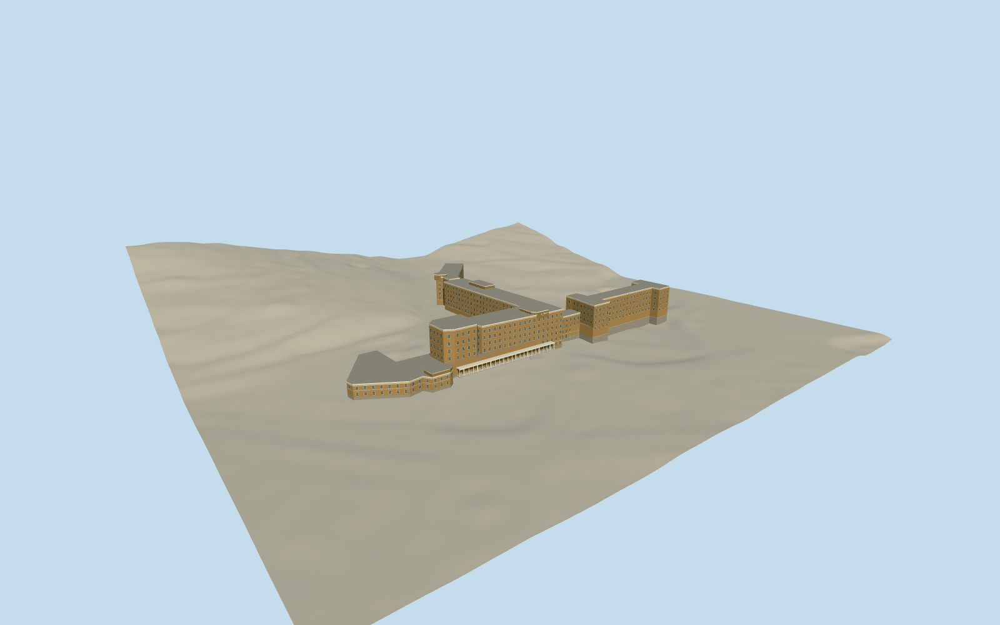

# French Lick Springs Hotel

French Lick Springs Hotel, with linked buff-brick wings, cornices and tower bays, a long white veranda and the lower former baths.

Authoring state: **review-in-qa.json**. Current completion evidence is in [qa.json](qa.json) and the [completion ledger](../../../../qualla-structures/batches/qualla-003.PROGRESS.md).

- [French Lick Springs Hotel](https://qualla.com/french-lick-springs-hotel/)

Exact upper floor boundaries, roof materials and rear glazing placement are estimated. A representative section is used for the visible height of each documented wing.

The shared original model depicts the attached hotel ranges. The separate casino, modern event building, pools, landscape structures and independent Pluto Spring pavilion are outside this model.

Build: `node content/worldgen/source/places/dn/dnf/french_lick_springs_hotel/models/generate-french-lick-springs-hotel.mjs`. Add `--check` to verify exact regeneration. 22265 triangles; 5 materials; no embedded photographs.
