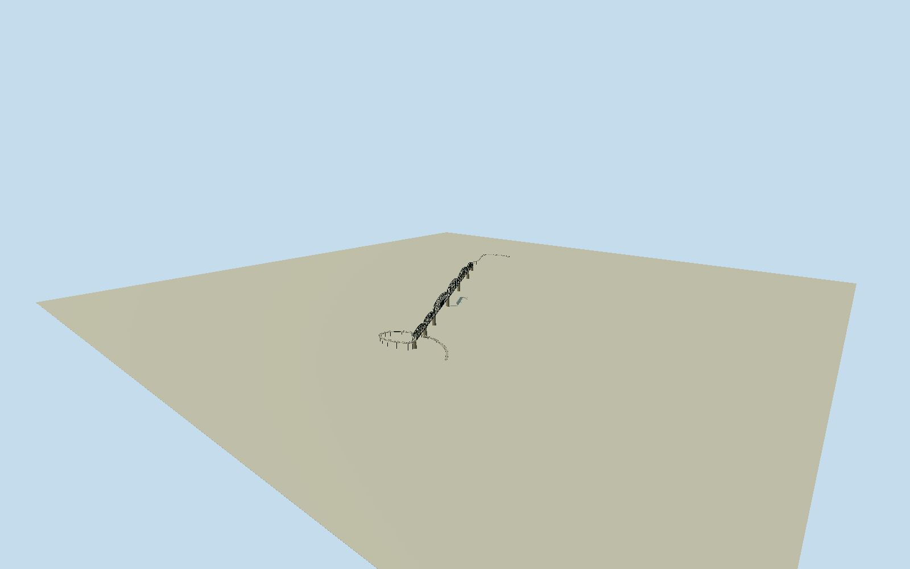

# Big Four Bridge

Whole six-span Big Four pedestrian bridge on exact778.1m native rivercentreline: one shortnorth/three longer Pennsylvania middles/two shortsouth Parker spans, dark polygonal upperchords/verticals/diagonal and secondarybracing/realstructuralvoids/upperlateralcrossbracing, pale6m walkway/physicalrails, five riverpiers/two endsupports, actual integral Louisville spiral and Jeffersonville descending curved ramp centrelines with deck/rails/columns. Two exactpublished2024creatorCC0 and2012creatorPD-self originals. Span boundaries/membersections/height/supportdetails/rivetcensus/currentfinefinish unsurveyed originalestimates. Parks/neighborbridges/river/temporary2012equipment/boats/people/arttext/photo pixels excluded.

Authoring state: **review-in-qa.json**. Current completion evidence is in [qa.json](qa.json) and the [completion ledger](../../../../qualla-structures/batches/qualla-002.PROGRESS.md).

- [Big Four Bridge](https://qualla.com/big-four-bridge/)

Whole physical bridge/native main centreline778.1074m north-south endpoint distance and native wholeboundary with both ramp centrelines. Heading0/+Xeast/+Zsouth, anchor midpoint of exact native main endpoints. Native6m paved walkway width does not establish trussouterwidth; steelwidth/verticalsections/spanboundaries/supportprofiles are original photographic estimates. Reference article describes three longer middle spans and three shorter endspans (one north/two south); normalized estimates preserve exact native endpoints, not a survey.

All sections authored after unchanged original1600m129x12916641sample/four rawtile/fixed northground-endpoint135.0347m providerrelative datum freeze. Exact native778.1074m bridge centreline and both native curved approaches retained. Six spans: shortnorth/three longer Pennsylvania middles/two shortsouth Parker spans. Source story547ft middle spans and sixspan2525ft total are informative, not asurvey; chosen relative spanweights normalized to nativewhole778.1074m endpoints. Original photographic deck+18m/walkway6m/truss8.4mwide/larger25m-rise/short17and15m-rise/5mramps/1.35mrails/taperedroundedstonepiers are unsurveyed estimates. Native south379.1414m/north393.5434m approach paths descend continuously by18m along respective arc lengths, consistent with roughly5percent nativeincline. Closedwalkdeck and physicalsteeltrusses/realstructuralvoids; hidden membersections, joints/lattice/rivets, individualpierstation/underwater foundations/currentcolor/census estimates. No groundfit/flatten/reacquire/raising; exact bank/ramp/piercontact and hydraulicclearance unresolved, preview/replacementfalse. Groundheight chosen once at fixednative endpoint, nevertofitmodel.

Two exactpublished2024Huskydaddyown-selfCC0 wholebridge/spiral and2012Nyttendown-PDself northpier/steel detail originals only. WesternsidePD photo inspected but unselected under unchanged publishedguard; no supplemental/reclassification/source repair. Current pedestrian conversion established by2024photo,2012temporaryconstruction/containers/crane/fences excluded. Six spans and both integral approaches retained, no detail-only substitute. Exacthiddenmember profiles/fasteners/census/spanstations/underwaterfoundations/height/currentfinefinish are original estimates. No operational/engineering/hydraulicclearance or traversal claim.

Original1600m129x12916641sample field/four rawtiles/fixednorthground135.0347m providerrelative datum frozen beforeallsections/geometry. No terrainfit/flatten/reacquire/modelraising. Exact bank/ramp/pier contact unresolved, preview/replaceFootprint=false. Flatground/syntheticneighbors are reviewfixtures only.

Build: `node content/worldgen/source/places/dn/dng/big_four_bridge/models/generate-big-four-bridge.mjs`. Add `--check` to verify exact regeneration. 28172 triangles; 3 materials; no embedded photographs.
