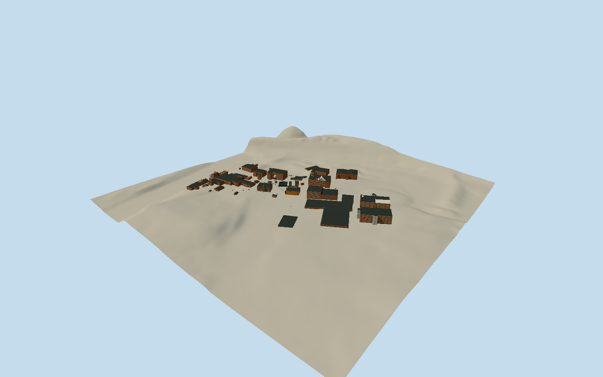

# Buffalo Trace Distillery

Whole contiguous main production and visitor campus, 68 native building footprints/166 native parts: riverside still/mash/fermentation/dryhouse/process blocks, six grain silos, four-leg water tower, historic C/D/I/H/B brick or metal rickhouses, K/L/M/N/O/P/Q/R/S/T/U warehouse groups, distribution centre, freehouse/bottling/visitor/guest/clubhouse/Taylor-house core and small intrinsic sheds. Exterior massing/roof shapes/bays/brickpilasters/stonebasement/industrialglazing/warehouseopenings/overheadlinks. Exclude separately sited remote northernwarehousefarms, unrelated surrounding houses/carshop/church/publicroads/river/landscape/artworks/paintedlogos and allinteriors. Richnativebuildingparts respected; Cstonebasement/three tallarchedbrickwindowrows/pilasters/quoins andtallstairbulkhead; Imanysmallindustrialopenings/cornerstair, Hpaleindustrialmetal/gable, D/Bbrickgables,1960sconcrete/tilewarehousefacadegrids. Greenframes/darkwindowrecesses, subduedbrick/concrete, darkroofs, whitedishedtank/dark4legopenXframe,6concretesilos. Neveruniformgenericboxes/onewatertoweraswholecampus.

Authoring state: **review-in-qa.json**. Current completion evidence is in [qa.json](qa.json) and the [completion ledger](../../../../qualla-structures/batches/qualla-002.PROGRESS.md).

- [Buffalo Trace Distillery](https://qualla.com/buffalo-trace-distillery/)

Native68maincampusbuildingpolygons and166parts/actualwater-towerfootprint fix frame [-84.86826635,38.2176181] heading0/+Xeast/+Zsouth beforeterrain/geometry. Namedlanduseparcel262912712/Q2927641 isidentitycontextonly, not extruded. PublishedAcdixon2017OwnCC0still/warehouse/watertower/OFC-Cphotos supportprimaryforms. PrimaryNationalRegister2000inventory gives87ftstill/80ftmash/58ftdryhouse,6silos, individualwarehousefloor/material/roofclasses. Nativemetricheights preferred forotherparts; building:levels×3m is explicitlyapproximateheightproxy, notsurveyedfloorcount. Partialparts are not treated as wholefloatingbuildings; parentmasses retainunmapped fabric. Nearactualwindowcounts/corebayproportions approximatefromclearphotos/primarydescription; hiddennewwings usehonestnativecontrols.

Whole contiguous main production/visitor campus: all mapped buildings from riverside still/mash/grain processing through historicbrick/metalrickhouses and concrete/tile warehouses east toU, visitor/guest/clubhouse/Taylor-house core. Excludes separate remote northernwarehouse farms, unrelated surroundinghouses/carshop/oldchurch, publicroads/river/landscape andwholelandownershipparcel. Individual physicalbuildings native, no parcel extrusion. Currentmappedmaincampusshell with primaryhistoricresourceforms; decorative/roof/height details vary inconfidence.

Whole68nativebuildingmaincampus,166nativeparts near; skyline usesorientedrectangles/mergedparts andomitssmallfacadewindows. Primarytextgivesstructure/material/roofclasses, clearpublishedphotossupportCarchbays/stonelowlevel,Imanysmallwindows/stair/whitefourlegwatertower/stillglazing. Hiddennewblocks/windowcensus/finehardware/roofridges andnativelevels3mheightproxy arearchitecturalestimates,notas-builtsurvey. Partialnativeparts sitoverinsetfullparentmasses toavoidfloatinginfill/omittedunmappedfabric; mainflat/gableridgegeometryapproximate.

Onewholemodelrepresentsthecontiguousmainproduction/visitorcampus, not allBuffaloTraceownedland/remote northernwarehousefarms. No industriallanduseparcel extrusion, isolatedwatertower substitution, publicroads/river/landscape/artworks/logos/signlettering/interiors/operatingmachinery.

Four exactpublishedAcdixon2017Own/selfCC0originals individuallyinspected/nativeSHA1bound, unchangedpolicy passes. NativeOSMcontrolsinODbL; primaryNRHP2000inventorytextfacts only. No protectedPDFphotos/plans/ownerpromotionalimages adopted, no Quallamedia/body/category/policy edits, photographictextures/downloadedmesh/generatedbitmap.

Independent1024m129square8m16641samplefield/fouroriginaltiles frozenbeforegeometry; allvalues/PNG/tilebytes preserved. Everyparentbase is preexistingfieldcentre elevation, not fabricated flatcampus floor. This mayembedcorners oncoarsecomposite terrain; no sourceflattening/fitting/reacquisition. Provider152.1041m fixedapproachdatum/actualhostgrade/footingcontact unverified; ordinarygeographicpreview/replacementdisabled.

Build: `node packages/worldgen/scripts/generate-authored-places.mjs --ids=buffalo_trace_distillery`. Add `--check` to verify exact regeneration. 60138 triangles; 6 materials; no embedded photographs.
