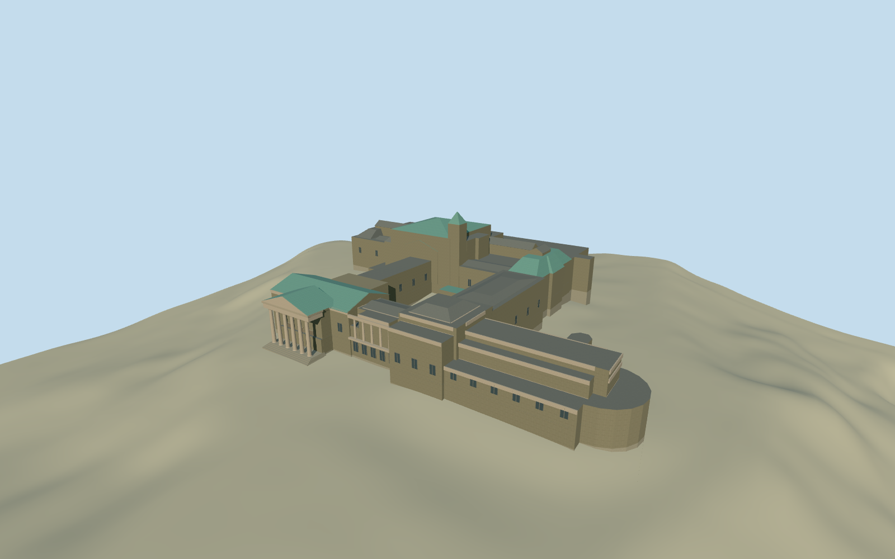

# Cincinnati Art Museum

The Cincinnati Art Museum in Eden Park with its classical entrance, original stone galleries and connected courtyard wings.

Authoring state: **review-in-qa.json**. Current completion evidence is in [qa.json](qa.json) and the [completion ledger](../../../../qualla-structures/batches/qualla-004.PROGRESS.md).

- [Cincinnati Art Museum](https://qualla.com/cincinnati-art-museum/)

The attached historical and modern wings are included. The Art Climb, park structures, artworks and interiors are outside scope.

Mapped roof forms and levels guide the massing. Heights across the sloping site and rear facade openings are estimated.

Build: `node content/worldgen/source/places/dn/dng/cincinnati_art_museum/models/generate-cincinnati-art-museum.mjs`. Add `--check` to verify exact regeneration. 9738 triangles; 8 materials; no embedded photographs.
