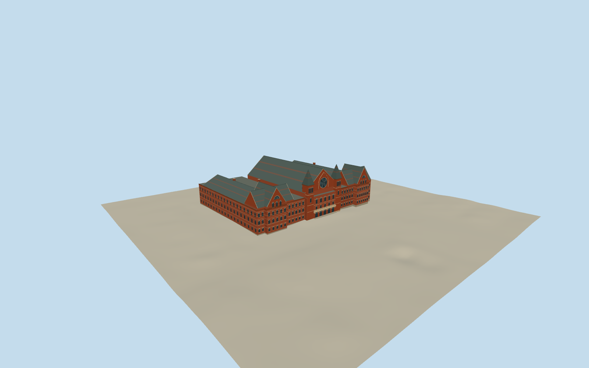

# Cincinnati Music Hall

Cincinnati Music Hall’s red-brick Elm Street front, sandstone bands, great rose window, paired pointed towers and lower exhibition wings.

Authoring state: **review-in-qa.json**. Current completion evidence is in [qa.json](qa.json) and the [completion ledger](../../../../qualla-structures/batches/qualla-003.PROGRESS.md).

- [Cincinnati Music Hall](https://qualla.com/cincinnati-music-hall/)

The model represents the post-restoration exterior in February 2019 at 1241 Elm Street.

OpenStreetMap controls the complete footprint and separate wing and tower locations. Roof pitches, component heights, rear service details and individual ornament dimensions are estimated.

The wider and closer public-domain photos control the Elm Street brick, sandstone bands, twin towers and roof silhouette. The earlier masonry detail informs only the surviving trim.

The original Terrarium elevation field is preserved. Local paving and step heights are approximate.

Build: `node content/worldgen/source/places/dn/dng/cincinnati_music_hall/models/generate-cincinnati-music-hall.mjs`. Add `--check` to verify exact regeneration. 15650 triangles; 5 materials; no embedded photographs.
