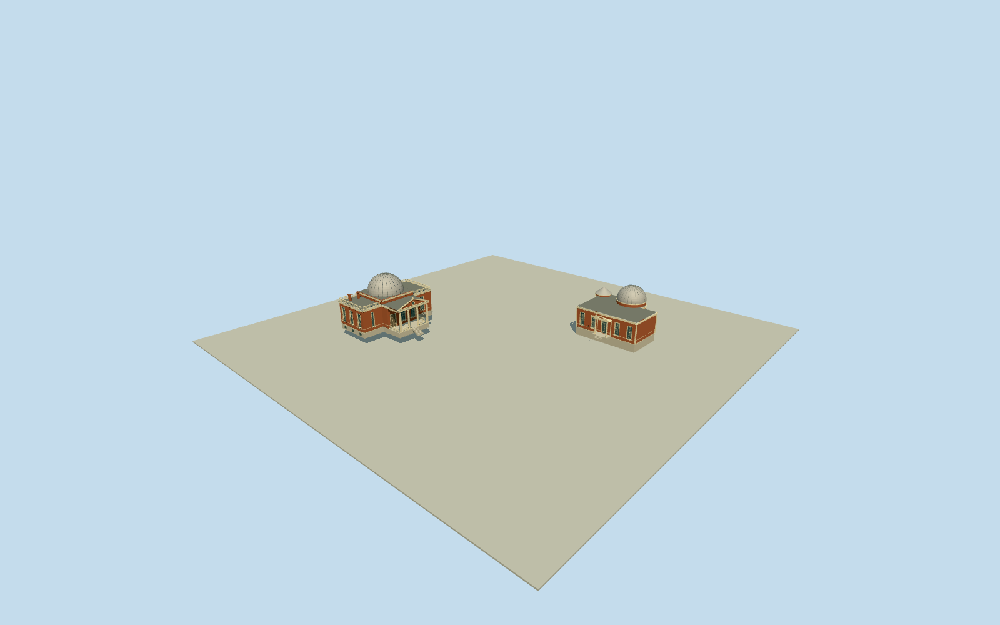

# Cincinnati Observatory

Complete separated Herget and Mitchel observatory buildings at original native positions: redbrick/raised stonebases/pale dressed sash, open south Herget Doric portico/pediment/oculus/steps/balustrades, flat roof balustrade/paired chimneys and ribbed silver dome on square support; west Mitchel two-column entry/lowpediment, central rear domed turret and smaller northeast conical turret. No campus slab/driveways/interiors/telescopes/temporaryworks.

Authoring state: **review-in-qa.json**. Current completion evidence is in [qa.json](qa.json) and the [completion ledger](../../../../qualla-structures/batches/qualla-002.PROGRESS.md).

- [Cincinnati Observatory](https://qualla.com/cincinnati-observatory/)

Original named Hergetway76811703/3489ObservatoryPlace and Mitchelway76811742/3474ObservatoryPlace, both operated by CincinnatiObservatoryCenter/Q3348364. Complete original17/22vertex footprints preserve separated buildings and two east/rear Mitchel round turrets. Herget boundingboxcenter[-84.4225883,39.13911825], heading0/east-southframe. Herget faces south; Mitchel faces west; buildings are NOT copied parallel clones or merged campus slab. Native map has no heights/roof partitions: dome/portico/hidden section heights are bounded photographic/registered-text estimates. Original plans, geographic offset and independent field stay unchanged.

Complete two intrinsic observatory building exteriors only. Original full map plans retain all17/22vertices; centimeter-scale collinear Herget wall jogs simplified between retained principal corners, with original full roof envelope. Silver Herget dome/portico/roof and Mitchel front controlled by two2019CC0exteriors. Primary architectural text and native curved plans establish concealed Mitchel main rear dome and northeast cone turret. Heights/vertical basement offsets/roof profiles/window census/ornaments/rear details remain bounded medium-fi estimates.

Operator reports Herget renovation beganJuly2026; temporary works and current cosmetic condition excluded/unverified. Permanent1895ribbed silver dome represented closed; no moving slit/telescope/interior. Main porch genuine open air below entablature; high windows recessed in nearer levels; open balustrades simplified at distance.

Shared procedural brick/limestone/painted-metal and muted local glazing; no photograph texture or generatedbitmap. Qualla-published exact4032x3024WarrenLeMayCC0exteriors/nativeSHA1matched before geometry. Interior/attic/markers/astronomy/unrelated/attribution imagery unused. Primary architectural document used only for text facts, no images/diagrams.

No separate radio tower/survey markers/driveways/grounds/landscape/campusslab/neighbor houses, interiors/telescopes/lettering/people/cars or temporaryrenovation. Independent original160mterrain/rawtiles/grid/heightPNG frozen unchanged; no flattening/fitting. Exact front stairs/downslopebase/hostcontact unverified; replaceFootprint=false.

Build: `node packages/worldgen/scripts/generate-authored-places.mjs --ids=cincinnati_observatory`. Add `--check` to verify exact regeneration. 26851 triangles; 7 materials; no embedded photographs.
