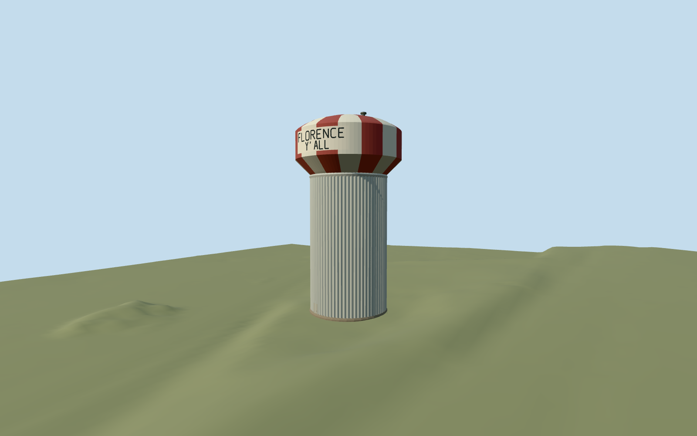

# Florence Y’all Water Tower

Florence Y’all Water Tower, with its white ribbed column and flared tank in red and white, and two-line interstate-facing lettering.

Authoring state: **review-in-qa.json**. Current completion evidence is in [qa.json](qa.json) and the [completion ledger](../../../../qualla-structures/batches/qualla-003.PROGRESS.md).

- [Florence Y'all Water Tower](https://qualla.com/florence-y-all-water-tower/)

Kentucky’s highest lidar return within the mapped tank is about 42.0 metres above the bare earth. The surface model locates the crown but does not resolve individual rods.

The mapped 22.73 metre crown and the measured elevation anchor the exterior. Shaft width, seam heights, vent sizes and corrugation spacing are fit to the photograph.

The 2024 Qualla photo establishes one painted sign and its viewing side. Ground service fittings and rear paint details are approximate.

Build: `node content/worldgen/source/places/dn/dng/florence_y_all_water_tower/models/generate-florence-y-all-water-tower.mjs`. Add `--check` to verify exact regeneration. 3284 triangles; 5 materials; no embedded photographs.
