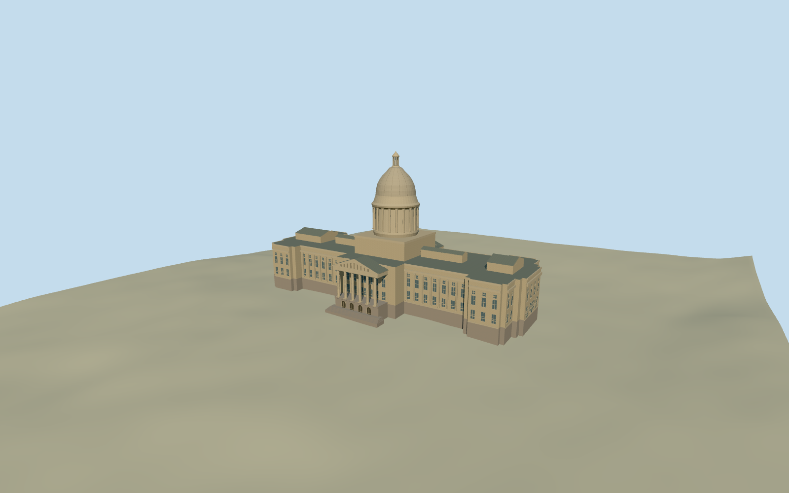

# Kentucky State Capitol

The Kentucky State Capitol in Frankfort with its limestone wings, Ionic north portico, domed drum and lantern.

Authoring state: **review-in-qa.json**. Current completion evidence is in [qa.json](qa.json) and the [completion ledger](../../../../qualla-structures/batches/qualla-004.PROGRESS.md).

- [Kentucky State Capitol](https://qualla.com/kentucky-state-capitol/)

The present Capitol shell, all four architectural elevations and attached porticoes. Free-standing statues, the landscaping layout and interior rooms are outside scope.

The lantern is scaled to the state’s published 212-foot dome height. Unpublished molding profiles, minor roof positions and decorative relief are estimated.

Build: `node content/worldgen/source/places/dn/dng/kentucky_state_capitol/models/generate-kentucky-state-capitol.mjs`. Add `--check` to verify exact regeneration. 24496 triangles; 7 materials; no embedded photographs.
