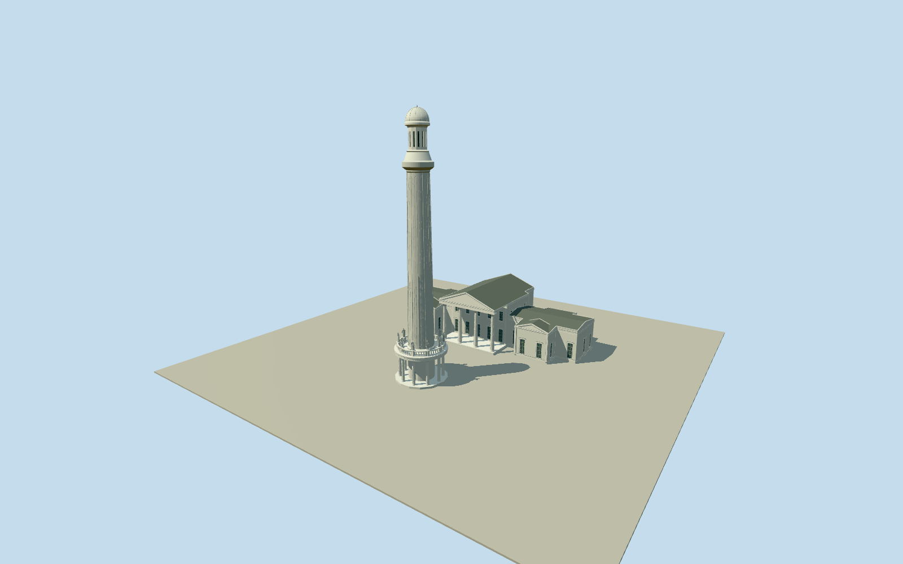

# Louisville Water Tower

Whole ornamental WaterTower and original1860whitePumpingStationNo1: actualnative17/36vertexplans/separatepositions, open10columncircularbase/balustrade/tenposedhumanstatues, tallribbedpaneledpaleironshaft/uppercapital/slottedlantern/ribbeddome/finial, highGreekpumpcenter/openfrontportico/pediment andcompleteattachedwings/endpavilions/dressedrecessedsash/slateroofs. No detachedlatercampusbuildings/river/site.

Authoring state: **review-in-qa.json**. Current completion evidence is in [qa.json](qa.json) and the [completion ledger](../../../../qualla-structures/batches/qualla-002.PROGRESS.md).

- [Louisville Water Tower](https://qualla.com/louisville-water-tower/)

Exactoriginal17vertextowerbaseway332331161/man_madewater_tower/Q3263909 and complete36vertexoriginalwhitepumphouseway332331169. NamedWaterWorksMuseumnode5146055222/Q17019049liesinsidepump at local[5.345,-28.941]; sourcephotoandownerhistoryidentify originalNo1building and both attachedlowwings. Tower anchor originalbasevertexmean[-85.70118943529413,38.28055582352941]; actualnativepump SEfrontstraightface10to11fixes heading0.5579686882207181rad; +Xnortheastacrosspumpfront/+Zsoutheastfront. Preserve fullnativepumpjogs/pavilions andtowercircle; do not substituteparkboundary/siteplatform or detached laterRomanesquehallsway332331167/othercampusbuildings. Towerfittedbasecenter[0.08128424771871767,-0.5307198486860636]withinoriginalring, individualcolonnade/shaft/sculptures approximate. Fixedsoutheastfrontapproach[0.08128424771871767,7.5]beforeterrain/geometry. NativepointUSGSrivergaugeele is separateproviderdatum, not a buildingfloor survey; unused. No nativebuildingheighttags; owner185ftoveralltower controls vertical silhouette.

Whole original WaterTowerandPumpingStationNo1 only; actual17/36vertexnativeplansandrelativepositions retained. Owner185ft/56.388moverallheight andtenstatuesareprimarycontrols. Allotherverticalsections, exactcolumn/rib/sashcensus, finecapitals/ornament/pumproofpartitionsandhiddenrearelevations remain bounded estimates from cleared2007exteriors andnativeplan.

Realopenlowercolonnade/annularcoveredwalk/closedcentralbaseentry, openbalusters andtenpedestalhumanfigures. Near statuary uses original posed generatedanatomy andsculpteddrapery/urn/hunterdog/raisedarm/hatattributes fromseveralvisiblePDcloseups; unseenposes/placementassignmentsestimated andnotportraitreplicas. Skyline preserves tower/pump heights, alltenlowercolumns/figures and mainwing/pavilion silhouette with simplified footprints/thin annular roof/rail proxies; districtcoarsensdrapery/anatomy/capitals and pump lights are flat shadow/glazing hints within the0.9merror. Nearlevelsaddpaneledshaft/ribs/rivets/dome details and genuinely recessed pump/lantern lights; streetcoarsens paintseams/roofmoldings below0.35merror. No interiorwaterpipe/engines.

Onlythree exact already-cleared publishedBedfordQualla1600x1200PDoriginals from2007; nativeSHA1/ownauthor/PD-user-w-or-en releases bound. Unrelated/food/grave/uncertain/attributionimageryunused. Riveroverviewviewedbutnotadopted. Ownertextonlysupports185ftheight/tenstatues/2024restoration; ownerwebphotographs/videos/docimagesunused. Shared proceduralplaster/paintedmetal/slate andmutedglazing, no copiedpixels/generatedbitmap.

Cleanpalefinishesrepresentpermanentarchitectureafter2024restoration;2007peelingpaint/temporaryscaffold/currentcosmeticsunverified. No detachedlaterRomanesque/yellowpumphalls/chimneys, river/USGSgauge/pylons/othercampusbuildings/roads/plazas/lawns/landscape/people/signage. Original160mterrain/rawtiles/grid/PNG unchanged at fixedfrontapproach; no flattening/fitting or connectinggroundslab; exactfloor/threshold/host contactunverified; replaceFootprintfalse.

Build: `node packages/worldgen/scripts/generate-authored-places.mjs --ids=louisville_water_tower`. Add `--check` to verify exact regeneration. 55095 triangles; 7 materials; no embedded photographs.
