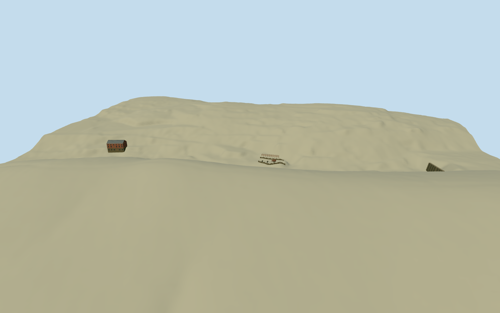

# Roswell Mill

The surviving Roswell Mill site on Vickery Creek, with the brick Machine Shop, stone mill ruins, exposed turbine and documented masonry dam.

Authoring state: **review-in-qa.json**. Current completion evidence is in [qa.json](qa.json) and the [completion ledger](../../../../qualla-structures/batches/qualla-003.PROGRESS.md).

- [Roswell Mill](https://qualla.com/roswell-mill/)

The machine shop eaves, openings and inaccessible wall details are approximate. The ruin row, turbine fittings and masonry course widths are inferred from ground-level photographs and measured site positions.

The mill dam is represented as a solid masonry form. Moving water, woodland, the modern covered bridge, the private redeveloped 1882 mill and the entire vanished factory are outside this model.

Build: `node content/worldgen/source/places/dn/dnh/roswell_mill/models/generate-roswell-mill.mjs`. Add `--check` to verify exact regeneration. 5336 triangles; 7 materials; no embedded photographs.
