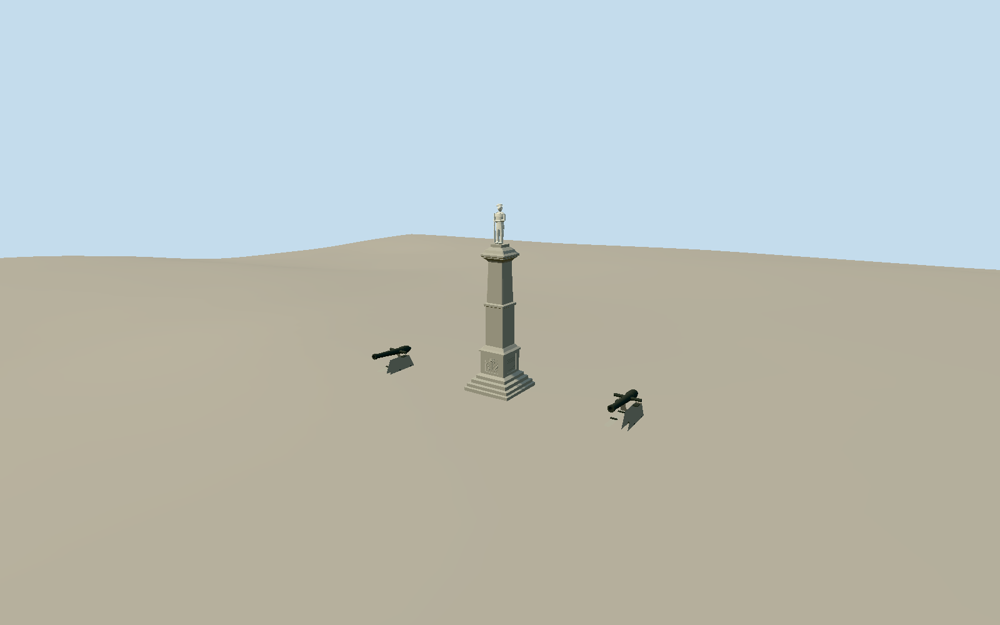

# Confederate Monument (Greenville, South Carolina)

Whole1892monument surviving at1924ConfederatePlaza location: tiered square granite steps/inscriptionbase, two-stage tapered square shaft, shoulder/cornice/cavetto capital, separate pale marble standinguniformedsoldier with brimmedhat/rifle/separatedlegs/waist-heldhands, and two intrinsicParrottgun displays onstonegarrisonmounts. Exclude independentDixieHighway/Kershaw/81stDivisionmemorials, laterbronzeplaques, cemetery/park/fences/roads/trees and originalMainStreetbuildings. Realfour-sidedgraniteprofile/plinthtiers/lowerrelief/closedinsetinscriptionpanels/midshaftband/taperedupperstage/cavettocapital. Paleunpaintedmarblesoldier: twoactualseparatedlegs/shoes/kneelengthuniformcoat/waisthands/longverticalrifle/brimmedslouchhat/restrainedface; no blockman/sphere-head substitute. BothdarkironParrottbarrels withbreechband/muzzlebores/trunnions andwheel-lessslopingstonecarriages. Nearmolding/coatseams/buttons/fingers/hatdent/eyelids/rifledetails areboundedinterpretations. No literal unreadabletextorcopiedcoloredpostcardlighting.

Authoring state: **review-in-qa.json**. Current completion evidence is in [qa.json](qa.json) and the [completion ledger](../../../../qualla-structures/batches/qualla-002.PROGRESS.md).

- [Confederate Monument (Greenville, South Carolina)](https://qualla.com/confederate-monument-greenville-south-carolina/)

Actualnativecentre node3894273805 namedConferateMonument at[-82.3967635,34.8552457], distinctfromnearbyDixieHighway/Kershaw/81stmemorials. Heading-2.087396266791048 inferredfromcentretocurrentnativeapproachjunction3894273809, notsurveyedstatuebearing. Nativecurrentcirclefootway42336424 isapproachcontext, not3Dbasefootprint. Nativecannon3894273806 atlocal[7.992581256819033,0.6601553993773255] pinsonegun; secondgun mirroredacrosscolumnisarchitecturalplacementestimate, notmeasuredmapcontrol.28ft8.5344mreportedgraniteshaft frompublishedQuallacaption, statue2.20m/whole10.7344marchitecturalestimate; Quallaflight25ftsummary isrough/conflicting, neitherheightassertedassurvey. Smalltierwidths/sections/portrait/ornament/gunprofile areproportionalphotographicestimates.

Wholegraniteshaft/plinth/cap/marblesoldier andtwoParrottdisplays included; bothlegvoids/hat/rifle/waistarms/fourfacecolumn/two-stageprofile retainedatalllevels. Nearclosedrecesspanels/moldings/restraintface/coatseam/buttons/fingers/bore/breech/trunnions/stonecheekmounts. Statueportrait/finefolds/reliefsymbol/gunmodel/calibre/currentcarriagerepairs andsmallcannonballs areapproximatephotographicinterpretations. Inscriptionrepresentedbyincisedlinefields, noliteralunreadableletteringinvented.

Exactpublished1907AmericanNewsCoNewYorkPD-US-expiredpostcard/nativeSHA1bound andindividuallyinspected; unchangedpolicy passed. OriginalMainStreetsetting/ironfence/house/rails notcurrentmodel. Unknown1918bookimage/1948unrenewedclaim/modernCCphotosunusedandunviewed. PrimaryCityhistory andpublishedtextheightcaption usedasfacts only; no protectedPDFmaps/photos/newimageryadopted. No Quallamedia/body/category/policyedits orphotographictextures/downloadedmesh/generatedbitmap.

Nativecurrentmonument3894273805/onegun3894273806/approachcircle42336424 fixcentre andonegun; approximateheadinginferredfromapproach. Secondguncentremirrored, notmapped. Reported28ftshaft8.5344m plusestimated2.20mstatue/10.7344mwholeheight; rough25ftQuallasummaryconflicts. Dimensions/rotationalbearingnotcertifiedsurvey. Smallmasonrytierwidths/ornament/portraitboundedestimates.

Independent256m129square2m16641samplefield/twooriginalTerrariumtiles frozenbeforegeometry, allvalues/PNG/tilebytes retained. Provider299.4093mfixedapproachdatum isnot surveyedplaza/foundationgrade. Gunbases independentlysamplepreexistingfield; no flattening/fitting/reacquisition/parkdisc. Actualhostcontactunverified andordinarygeographicpreview/replacementdisabled.

SeparateDixieHighway/Kershaw/81stDivisionmemorials/laterbronzeplaques/cemetery/park/fences/roads/trees/people areexcluded, notsubstitutedfornamedmonument.

Build: `node packages/worldgen/scripts/generate-authored-places.mjs --ids=confederate_monument_greenville_south_carolina`. Add `--check` to verify exact regeneration. 6384 triangles; 3 materials; no embedded photographs.
