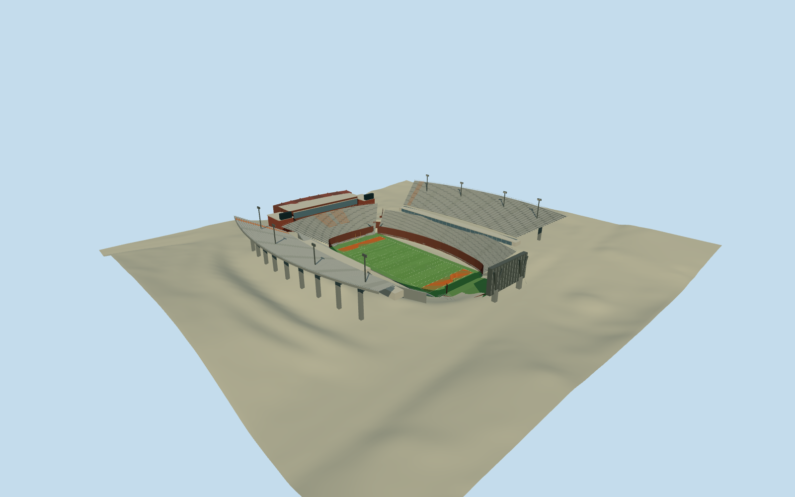

# Memorial Stadium (Clemson)

Clemson Memorial Stadium with Frank Howard Field, the twin upper decks, the WestZone and East Hill scoreboard.

Authoring state: **review-in-qa.json**. Current completion evidence is in [qa.json](qa.json) and the [completion ledger](../../../../qualla-structures/batches/qualla-004.PROGRESS.md).

- [Memorial Stadium (Clemson)](https://qualla.com/memorial-stadium-clemson/)

Both exact daytime seating views predate the newest scoreboard. The field footprint and scoreboard dimensions are independently controlled.

Upper deck heights, precise row positions, stair bays and WestZone side elevations are estimates from the mapped shape and photographs.

Scope covers the standing stadium complex. Separate parking and the opposite memorial park are outside the structure envelope.

Build: `node content/worldgen/source/places/dn/dnj/memorial_stadium_clemson/models/generate-memorial-stadium-clemson.mjs`. Add `--check` to verify exact regeneration. 29347 triangles; 7 materials; no embedded photographs.
