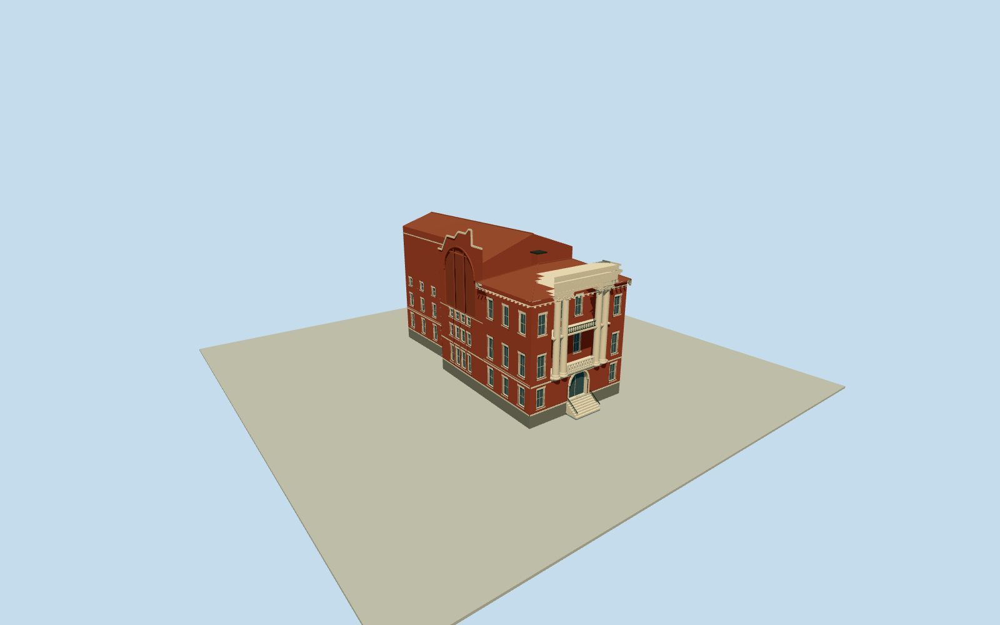

# Asheville Masonic Temple

Complete80BroadwayTemple and intrinsic connected rear hall, full original touching native plans: pressed redbrick/darkgranitebase/pale dressed sash and bands, genuinely recessed west two-story paired Ionic portico/lowerstonebalusters/uppermetalrail, recessed arched closed entry/ownsteps, bracketed front redtile hip roof/chimney, rearhall gable roof and shaped Woodfin parapet/three tall blind thermal recesses. No neighbors/site/interiors/lettering.

Authoring state: **review-in-qa.json**. Current completion evidence is in [qa.json](qa.json) and the [completion ledger](../../../../qualla-structures/batches/qualla-002.PROGRESS.md).

- [Asheville Masonic Temple](https://qualla.com/asheville-masonic-temple/)

Specific80BroadwayTemple identified by original story coordinate within nativeway490235622 and owner address at Broadway/Woodfin. Native unnamed five-vertex front way490235622 and touching four-vertex hall way490235623 retained in full, joined along exact shared edge. Three inspected CC0exteriors and primary historic district text confirm west hipped front plus east gabled hall as one Temple. Whole union seven-vertex perimeter, not just the story-containing polygon. Anchor[-82.55239931999999,35.59814604]. Actual west front edge original0to4 fixes heading-1.2856986178660197rad; +Xsouthward along front/+Zwest/front. No native heights or roof/window census; estimates from photos/text. Neighbor east beyondhall excluded. Front approach fixed before terrain/geometry.

Complete west Temple/front and intrinsic connected east hall; original5/4vertexnativeplans and sevenvertexunion retained in foundation. Three CC0exteriors and primary historic district text establish hipped front roof/gabledhall, four paired Ionic columns, open two-level portico, dark granitebase, dressed sash/bands and shaped Woodfin blind thermal field. Geometry heights, precise roof partitions/window census/volute profiles/balusters and concealed south/east elevations remain bounded estimates. Skyline uses simplified portico recess/columns/parapet and rearroof; nearlevels add true window/loggia recesses, scroll capitals, balusters, sash, arch reveals and brackets.

Front upper portico is recessed2.15m with closed back glazing, lowerstonebalustrade and uppermetalrail. Lower entry arch closes at inset door. Woodfin tall arch field is blind brick with shallow recess and two dividing piers, not transparent glazing. Rear roof and south/east windows are inferred where hidden; no interiors, text or Masonic artwork.

Only three exact already-cleared published WarrenLeMayCC0Qualla exteriors from2019, native original SHA1/source author/explicitcc-zero matched. Primary operator and historic district architectural text facts only; their images/drawings unused. Shared procedural brick/granite/limestone/ceramictile/paintedmetal and mutedglass, no copied pixels/generatedbitmap.

No adjacent buildings, street/sidewalk/site slab/landscape/trees/signals/people/cars/lampposts/flags. Original independent160mterrain/rawtiles/grid/heightPNG frozen before geometry at fixed front approach; no flattening/fitting. Exact basement/stair/sill/host contact and current cosmetic condition unverified; replaceFootprint=false.

Build: `node packages/worldgen/scripts/generate-authored-places.mjs --ids=asheville_masonic_temple`. Add `--check` to verify exact regeneration. 13557 triangles; 6 materials; no embedded photographs.
