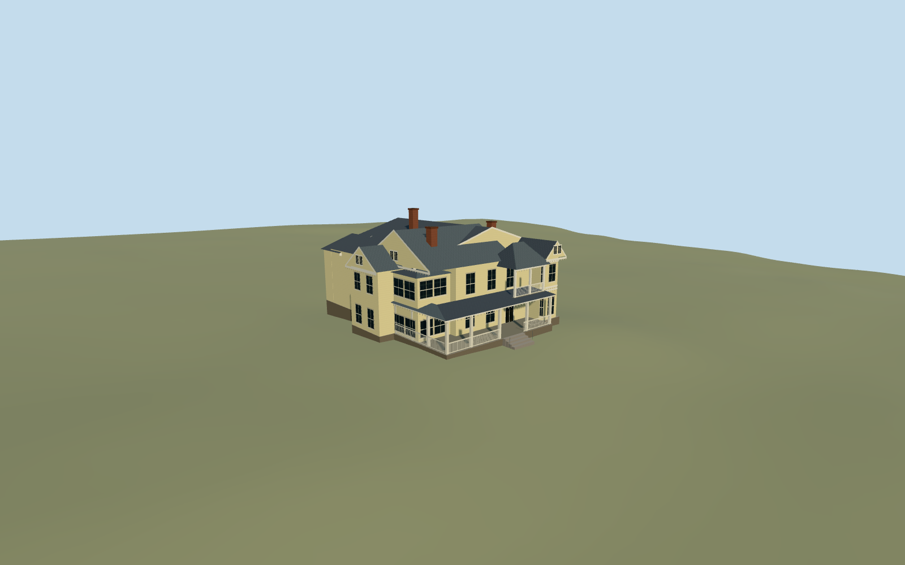

# Thomas Wolfe House

Restored yellow clapboard boarding house on North Spruce Street with a wraparound veranda, upper balcony, window bay and brick chimneys.

Authoring state: **review-in-qa.json**. Current completion evidence is in [qa.json](qa.json) and the [completion ledger](../../../../qualla-structures/batches/qualla-003.PROGRESS.md).

- [Thomas Wolfe House](https://qualla.com/thomas-wolfe-house/)

Roof heights, rear window locations and the returns of the enclosed side porch are estimated from the photographs and mapped perimeter.

The model simplifies wood brackets, leaded glazing and veranda balusters. It depicts the standing restored building.

Build: `node content/worldgen/source/places/dn/dnm/thomas_wolfe_house/models/generate-thomas-wolfe-house.mjs`. Add `--check` to verify exact regeneration. 3084 triangles; 6 materials; no embedded photographs.
