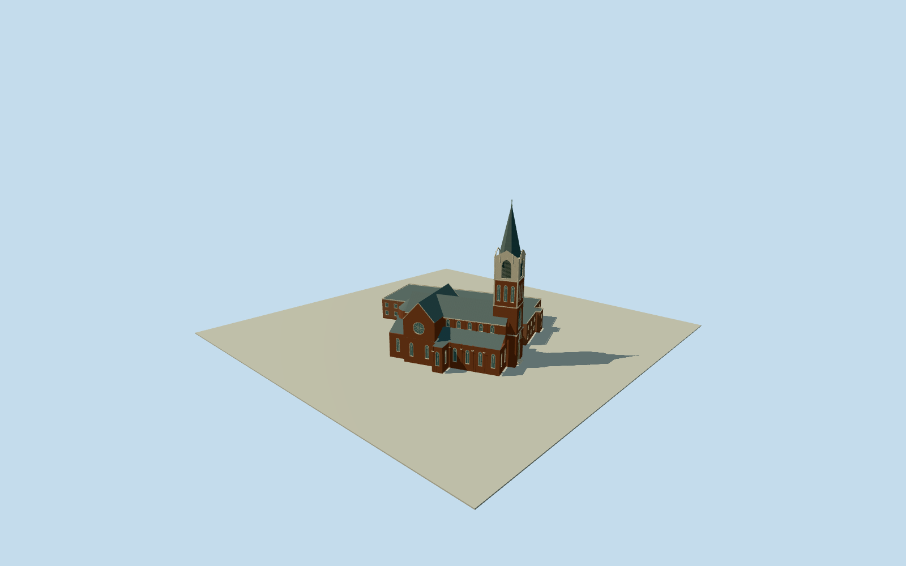

# Basilica of Saint Peter, Columbia

Whole actual native39-control Columbia basilica/connectedwing/corridor compound: dark red brick high nave/low sideaisles/shallow transepts/polygonalapse/ambulatory, physical lancet/rose/entrance recesses with original plain tinted glazing/tracery, stepped buttresses/corbel cornices, central entrance tower/tripartite window/twelve upper lancets/four actual louver recesses/white Gothic gables and pinnacles/slate octagonal spire/LatinCross. Whole northern attached brick wing and eastconnector retained with original bounded sections/fenestration. Exact cleared published Qualla2009KudzuVine ownPD photo first; no copied stainedglass/art/photo pixels. Primary historic163ft=49.6824m ground-to-cross; whole compound exceeds church-only dimensions. Hidden front/wing/currentfinish/exactgradecontact original estimates.

Authoring state: **review-in-qa.json**. Current completion evidence is in [qa.json](qa.json) and the [completion ledger](../../../../qualla-structures/batches/qualla-002.PROGRESS.md).

- [Basilica of St. Peter (Columbia, South Carolina)](https://qualla.com/basilica-of-st-peter-columbia-south-carolina/)

Exact whole named native39control way513681742/Q7591423, including attached compound rather than an invented church-only rectangle. Fixed nativebboxanchor/heading0/+Xeast+Zsouth chosen before independent terrain/floor/sections. Original rotated outline retained. Primary1989architect/committee NationalRegister text supplies historic church-only dimensions and architectural facts; no protected imagery/plans copied. Modern attachedwing/surveyed internal parts/exactgrades not verified.

Whole39-control native compound and fixed bboxanchor/heading0 retained; original256m129x12916641samples/one rawtile/SW93.0425m provider-relative datum frozen before every floor/section/geometry choice. Floor0.7179m chosen once from original grid at eastern entrance before geometry, no refitting/reframing/reacquisition/flattening/late modelraise. Primary1989architect/committee NRHP facts: historicchurch131ftlong/64ftnave-and-aisles/79fttransept/163ftground-to-cross/12ftrose, cruciformhighnave/lowaisles/polygonalapse/5bays/centralGothictower/3lancetsperupperface/4louvergables/octagonalslatespire/redbrick/lightstoneandterracotta;1967northattachment. Original estimated sections: aisle7.6/nave13.2-18.8/transept13.6-19.3/apse13.2-17.2/hiddennorthwing7.1-7.42/connector4.2; tower9.8/18.5/26.5-35.4, spire33.2-47.65/finial48.35/cross49.6824. Native interior roof-part joins/hiddennorthwingheight-flat-roof/fenestration/frontdetails/roofprofiles/finecarving/currentfinish all original estimates, not surveyed or mapped buildingparts. Wholephysicalscope retained including all39 native perimeter controls; no cemetery/separate school/interiors/art/copiedsourcepixels. Exactgradecontact unverified, preview/replaceFootprintfalse.

Cleared published Qualla2009KudzuVine own/PD-self original individually inspected/nativeSHA1matched and unchanged policy guard passed. Abductive conflictedhero, attribution/sharealike photos, uncertain historical postcard and Flickr some-rights-reserved source excluded unchanged without source/rights repair or same-image bypass. Primary architect/committee NationalRegister text factual dimensions/details only; no nomination photographs or protected stained-glass/figure art copied. Roof/part joins/hidden facade/large northern wing height-flat roof/fenestration/fine tracery/currentfinish original estimates. Generic plain glazing/original tracery, no interior/art/cemetery/separate school/grounds/trees/sourcepixels.

Original independent256m129x12916641samples/one rawtile/fixedSW93.0425m provider-relative source datum frozen before all floors/sections/geometry. Floor.7179m fixed once from original eastern entry sample before geometry; nativebbox frame unchanged/no terrainfit/flatten/reacquisition/modelraising. Exact grades/threshold/constructioncontact unverified; geographicpreview/replaceFootprint=false. Flat reviewground/syntheticneighbors are fixtures.

Build: `node content/worldgen/source/places/dn/dnn/basilica_of_st_peter_columbia_south_carolina/models/generate-st-peters-basilica-columbia.mjs`. Add `--check` to verify exact regeneration. 30715 triangles; 5 materials; no embedded photographs.
