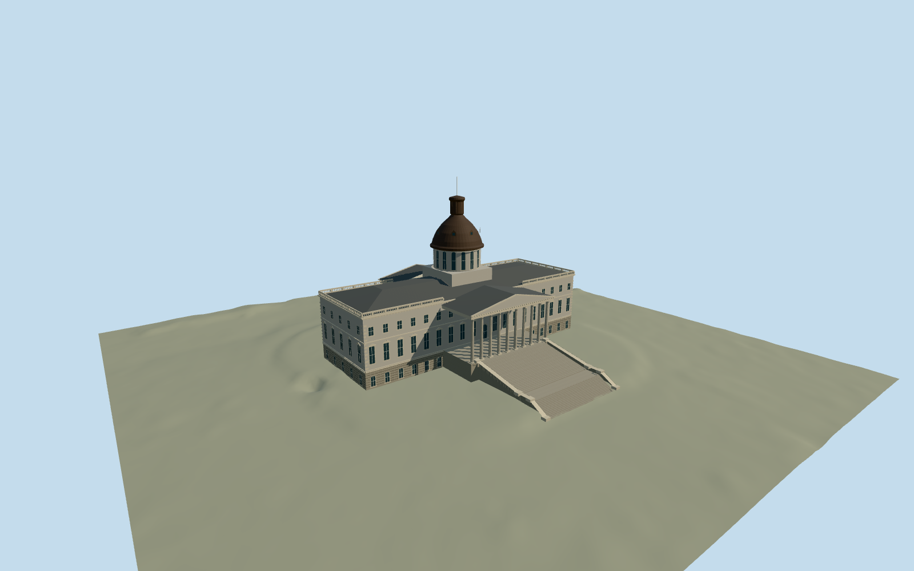

# South Carolina State House

Columbia State House with its two ten-column granite porticoes, matching double stairs, rusticated basement, balustrade and dark copper dome.

Authoring state: **review-in-qa.json**. Current completion evidence is in [qa.json](qa.json) and the [local 100 ledger](../../../../qualla-structures/batches/PROGRESS.md).

- [South Carolina State House](https://qualla.com/south-carolina-state-house/)

Roof details, lantern and window surrounds are simplified. The upper dome, drum and flagstaff heights are estimated within the documented overall height.

The stair centerlines follow mapped approaches. Individual step risers, granite balusters and rear thresholds are simplified. Native ground levels are recent USGS bare-earth values.

The model covers the building and its connected stairs. Independent monuments, scattered lamps, the visitor underground entrance and interiors are outside the model scope.

Build: `node content/worldgen/source/places/dn/dnn/south_carolina_state_house/models/generate-south-carolina-state-house.mjs`. Add `--check` to verify exact regeneration. 20318 triangles; 6 materials; no embedded photographs.
