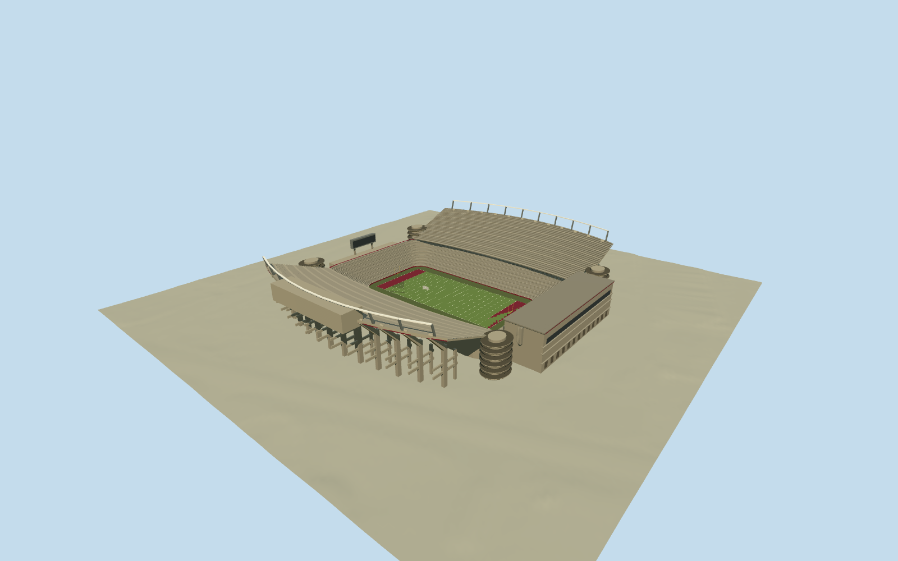

# Williams–Brice Stadium (2006)

The 2006 Williams–Brice Stadium bowl, concrete side decks and lights, stacked access ramps and enlarged south end.

Authoring state: **review-in-qa.json**. Current completion evidence is in [qa.json](qa.json) and the [completion ledger](../../../../qualla-structures/batches/qualla-004.PROGRESS.md).

- [Williams-Brice Stadium](https://qualla.com/williams-brice-stadium/)

The depiction is dated October 2006. Later renovations, including the 2012 north video board and subsequent concourse upgrades, are outside this configuration.

Mapped plan controls fix the field, main deck spans and site orientation. Deck sectional heights, individual benches, signwork, services and small fixture details use bounded estimates.

Build: `node content/worldgen/source/places/dn/dnn/williams_brice_stadium/models/generate-williams-brice-stadium.mjs`. Add `--check` to verify exact regeneration. 15290 triangles; 4 materials; no embedded photographs.
