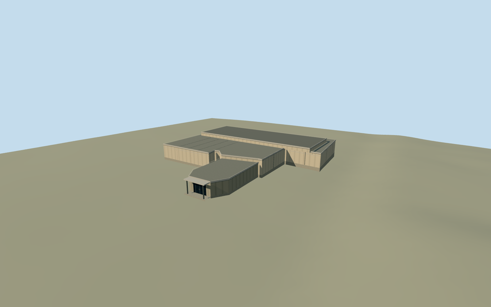

# 82nd Airborne Division War Memorial Museum

The public museum at Fort Bragg, with its low, stepped gallery wings, projecting entrance and independently surveyed irregular footprint.

Authoring state: **review-in-qa.json**. Current completion evidence is in [qa.json](qa.json) and the [completion ledger](../../../../qualla-structures/batches/qualla-003.PROGRESS.md).

- [82nd Airborne Division War Memorial Museum](https://qualla.com/82nd-airborne-division-war-memorial-museum/)
- [Fort Bragg](https://qualla.com/fort-bragg/)

The named footprint and state roofline establish the plan. Undocumented wall heights, cladding, service-side openings and roof profiles are approximations.

This exterior represents the public museum building. It excludes the exhibits, memorials, aircraft, campus circulation and other structures.

Build: `node content/worldgen/source/places/dn/dnp/airborne_division_war_memorial_museum/models/generate-airborne-division-war-memorial-museum.mjs`. Add `--check` to verify exact regeneration. 473 triangles; 5 materials; no embedded photographs.
