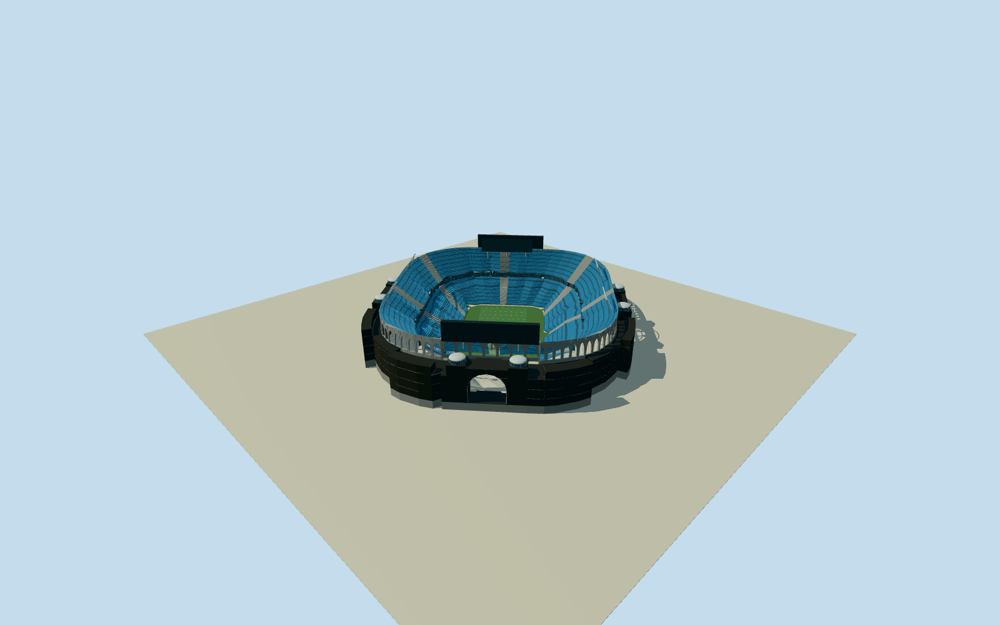

# Bank of America Stadium

Complete open-air Bank of America Stadium: native whole98/open-field40/control component rings, six domed towers, three actual open monumental arches, tiered blue seating/gray aisles and twin dark suitebands, end video structures and angled white floodlight banks. Exact cleared published USGS2002 public-domain aerial and Gardner2021 CC0 bowl photo first/only. Native heights plus operator architectural facts; fine sections/rows/census/hidden structure/contact bounded estimates. No future renovation, ads/sculptures/interiors/practice facilities/parking/landscape.

Authoring state: **review-in-qa.json**. Current completion evidence is in [qa.json](qa.json) and the [completion ledger](../../../../qualla-structures/batches/qualla-002.PROGRESS.md).

- [Bank of America Stadium](https://qualla.com/bank-of-america-stadium/)

Actual native complete stadium building relation12346952/outerway180768146/inner1245929758 plus physically associated mapped bowl/tower/facade/light components, whole bbox anchor/heading0 frozen before independent field/floor/sections/geometry. OSM heights are source-tagged estimates, not a survey.

Native stadium whole98/openfield40 controls retained everyLOD. Native lower140/club180/upper51 contour points and physically associated facade/tower/service/light parts retained in detailedLODs; distant seating and domes simplify while retaining exact native whole footprint/open field and component locations. Source OSM heights7/15/43m tiers,24/27/31m facades,33m tower surrounds/38m domes/58m light structures are approximate tagged controls, not survey heights. No offsite high-rise polygons used.

Original independent512m129x12916641samples/two rawtiles/SW224.186m providerdatum fixed before once-only southwest entry exterior floor-7.0036m and all sections/geometry. Field−6.3128m inferred consistently from native58m upper fixtures and operator211ft field-to-scoreboard; not surveyed field excavation. Native tiers7/15/43m, upperstart20m, twin suitebands15–20m, towers33/36/38m, portal.8/13/27m, boards41.0968–58.0128m/60.452m wide selected once before geometry. Bowl row counts/aisles/support thickness/hiddenprofile/finish/light census/contact original bounded estimates. No fitting/flattening/reacquire/reframe/late raise. Intrinsic bowl terrain opening bounded by actual upper-bowl masonry contour; source DEM bytes untouched, preview/replacementfalse.

Two exact published public-domain/CC0 originals first/only; no questionable sources or metadata repair. Native plan and enduring shell represented, no speculative future renovation. Row counts/individual seats/aisles/hidden support and rear details are original simplified estimates. Blank screens/field omit protected branding/ads/art, no surrounding city/practice facilities/parking/sculptures copied.

Original independent512mfield/two raw tiles preserved. Below-grade field offset inferred from native fixture height/primary field-to-scoreboard dimension, not survey. Intrinsic native bowl ground opening for preview; portable low ground/context neighbors are fixtures; exact plaza/foundation/field contacts unverified, replacementfalse.

Build: `node content/worldgen/source/places/dn/dnq/bank_of_america_stadium/models/generate-bank-of-america-stadium.mjs`. Add `--check` to verify exact regeneration. 61416 triangles; 6 materials; no embedded photographs.
