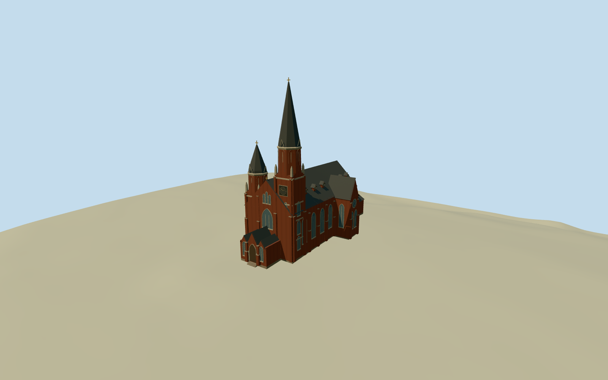

# Belmont Abbey, North Carolina

Belmont Abbey’s cruciform brick basilica, with uneven octagonal spires, a clock on the southern tower, and a three-gabled west narthex.

Authoring state: **review-in-qa.json**. Current completion evidence is in [qa.json](qa.json) and the [completion ledger](../../../../qualla-structures/batches/qualla-004.PROGRESS.md).

- [Belmont Abbey, North Carolina](https://qualla.com/belmont-abbey-north-carolina/)

Abbey Basilica exterior only. The separate monastery and college buildings, courtyard statue and church interior are outside the asset.

The two spire heights follow local published figures. Eaves, belfry sections and secondary brick and glass details are estimated from the mapped geometry and photographs.

Build: `node content/worldgen/source/places/dn/dnq/belmont_abbey_north_carolina/models/generate-belmont-abbey-north-carolina.mjs`. Add `--check` to verify exact regeneration. 10650 triangles; 5 materials; no embedded photographs.
