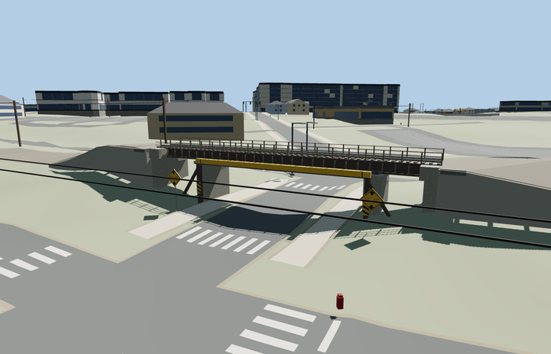

# 11 foot 8 / Gregson Street Bridge, Durham

Reviewed 2026-10-27. **Scoped current medium-fi exterior and approximate native placement complete.**

Inspected 62 current frames: 11 portable, 11 shared-material/geographic, 23 medium-fi and 17 native. Narrow brown plate girders, lower flanges/stiffeners, transverse floor beams, three lower openings, concrete supports/caps/bearings, two rails/ties, slender wire fence and separate yellow crash beam with outboard braces are present. Both north-facing diamonds retain outward-readable current 12 ft 4 digits and arrows. Historical 11 ft 8 signage and flashing-beacon layout are not presented as current. Lowered the initial native datum by about 0.345m in this same pass after actual clearance probes showed the first placement was too high.

Four existing shared 256px graphs: concrete_plain, metal_painted, wood_plain and gravel. Four merged material groups near, one mean-tinted group at skyline. Metric UVs and linear tints; no private/embedded images or copied photograph pixels. Each graph is fetched once in near native views. Runtime models use four separate GPU attribute streams.

| Level | Triangles | Bytes | Draws |
| --- | ---: | ---: | ---: |
| skyline | 440 | 41200 | 1 |
| district | 1400 | 129912 | 4 |
| street | 2876 | 261684 | 4 |
| closeup | 8020 | 668396 | 4 |

Master: 9876 triangles / 1188020 bytes. Runtime levels: 440 / 1400 / 2876 / 8020 triangles, 41200 / 129912 / 261684 / 668396 bytes and 1 / 4 / 4 / 4 draws. Initial skyline plus district 171112 bytes. Strict medium-fi budgets pass; physical-device timings remain unmeasured.

Retained exact-QID OSM way 515431845/Q22905940 footprint, confirmed against named current PMTiles rail bridge 35184388610530 and separate South Gregson Street 35184388623460. Anchor [-78.910131576,35.999075515], heading -0.604004960215: +X east-southeast toward Durham station, -X west-northwest; +Z south-southwest toward West Pettigrew, -Z north-northeast toward West Peabody and the southbound Gregson approach. Crash beam and current clearance diamonds face -Z. Source plan 28.833m by 3.101m is retained; the 6.4m replacement width adapts the renderer’s default rail bed, not a wider claimed bridge. All 12 mapped rail-bed width samples have model support at every LOD; eight retain native paving and meet within 0.026536230180454368m, while four lie inside replacement and are not called pavement joins. Fifteen actual upward road-width/station raycasts retain at least 3.7800004245684704m beneath rendered girders/crash beam. This is approximate standard-terrain fit, not a surveyed or legal clearance certification.

All 234 resident buildings, 524 input/output road records and 487 independent road records remain. The two lower Gregson records and four checked tunnel/sidewalk records retain their inputs and receive zero authored connections. Only the bridge rail feature and its connected rail approach record receive deliberate adaptation. Raw roads, DEM, displayed ground and water remain unchanged; failed loading keeps the map bridge and road, and unload releases every model/support geometry. No ground/building cutout is used.

## Reconstruction limits

- Scoped current rail-overpass exterior with separate crash beam and two posted-clearance diamonds. Exact-QID plan 28.833m by 3.101m is retained; piers at -9.5/+7.8m are photo-led fit controls outside mapped sidewalks, not surveyed span or footing dimensions. The original 11 ft 8 name is historical; visible signs read 12 ft 4.
- Source origin 118.61369353579312m is adjusted against15 actual native lower-road width/station raycasts to retain an approximately3.78m minimum geometric gap. Girder/crash-beam heights preserve an open low-clearance visualization. Mapzen smooths the railway embankment and road depression; a posted clearance label does not certify the modeled or legal passage height.
- The 6.4m road-replacement width adapts the renderer’s default rail-bed width, not a wider claimed bridge. The body retains 3.101m width; small flared ballast landing overlaps cover the incoming generalized railway bed. Underlying Gregson Street and sidewalks must remain independent and ungraded.
- The remote overheight detector, traffic signals, overhead warning portal, utility poles/cables, adjacent buildings, vegetation and complete retaining embankments are contextual features, not separate modeled landmarks. No old flashing beacon configuration is claimed to be current. The crash beam’s exact offset, support sections, fence/wire count, fasteners and wear are simplified.
- Four existing shared 256px graphs concrete_plain, metal_painted, wood_plain and gravel, metric UVs and linear vertex tints; no embedded/private images or copied photo pixels. Far LOD omits text, fence wires, ties and stiffeners; close levels retain current clearance digits, arrows and beams. Physical laptop and phone timings remain unmeasured.
- The posted 12 ft 4 label is supported by the primary operator and post-raise picture; the actual modeled minimum is about 3.78m only at the inspected standard-terrain samples. Coarse native road crown, embankment faces, approximate piers/abutments and rail sections remain explicit reconstruction limits.
- Incoming native rail beds are generic procedural paving; the model preserves detailed rails/ties on the bridge but does not claim continuous detailed railway tracks beyond its landing caps. Native nearby utility wires and traffic furniture remain context.
