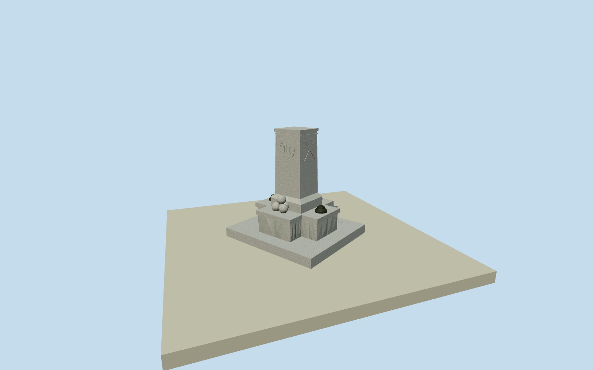

# Confederate Soldiers Monument, Durham — September 2019

Entire photographed September2019remnant of Durham memorial: low granite slab/cruciform rock-faced blocks/cap/plinth/battered neck/tapered framed shaft/round seal/two side crossed-flag reliefs/four cannonballs/two broken lamp plinths. Three exact published WarrenLeMayCC0obliques. Soldier already absent in represented condition, whole remaining base removed2020. Historical2019-09-01date only, excluded current world. Original photo-proportioned exterior with approximate former point registration.

Authoring state: **review-in-qa.json**. Current completion evidence is in [qa.json](qa.json) and the [completion ledger](../../../../qualla-structures/batches/qualla-002.PROGRESS.md).

- [Confederate Soldiers Monument (Durham, North Carolina)](https://qualla.com/confederate-soldiers-monument-durham-north-carolina/)

Q39073820 native geographic point agrees exact published Qualla story, precision0.00001degree. Original estimated3.0x2.7m intrinsic foundation outline and southwest-facing front are bounded original photo-derived proportions, not a surviving native footprint/survey. Whole named removed memorial distinguished from courthouse/planted curb and other monuments. Historical date registration remains approximate.

Complete surviving monument remnant exactly as represented by three published2019-09-01WarrenLeMayCC0photos: whole intrinsic low stone slab/cruciform granite lower blocks/capping slab/tall square slightly tapered memorial shaft/frame strips/top cap/round front seal/paired side crossed-flag low relief/four-cannonball stack and opposite damaged lamp plinths. Bronze soldier was already removed in2017; no invented intact1924statue or current surviving monument is claimed. Entire base removed2020; date opt-in only2019-09-01. Courthouse, sidewalk, landscaped planting curb, flagpole, benches, trees/flowers/temporary debris and interiors remain separate context.

Once-only floor0 at previously fixed front approach datum; all photo-proportioned sections fixed now before model geometry. Original source field is current unclassified context, not2019survey. No subsequent floor/mainsection/source mutation; historic exactcontact unverified.

All dimensions, intrinsic cross/slab proportions, shaft taper/section heights, rough faces, medallion/flag details, cannonball stack and damaged lamp fragments are bounded original photo-derived estimates. No measured native perimeter exists; geographic point/orientation/2019grade/contact remain approximate. Fine inscription typography/seal heraldry and temporary flowers/debris not reproduced. All intrinsic physical remnant parts retained.

Historical appearance is only exact documented2019-09-01day; bronze figure had already gone in2017. No full intact1924reconstruction is asserted, no modern surviving structure/default-world activation. Existing courthouse/planting curb/sidewalk/trees/flagpole/benches are separate context. Current original terrain is not a historic ground survey and may meet/intersect lower base; source field/frame/floor/mainsections fixed.

Build: `node content/worldgen/source/places/dn/dnr/confederate_soldiers_monument_durham_north_carolina/models/generate-durham-confederate-monument.mjs`. Add `--check` to verify exact regeneration. 3408 triangles; 2 materials; no embedded photographs.
