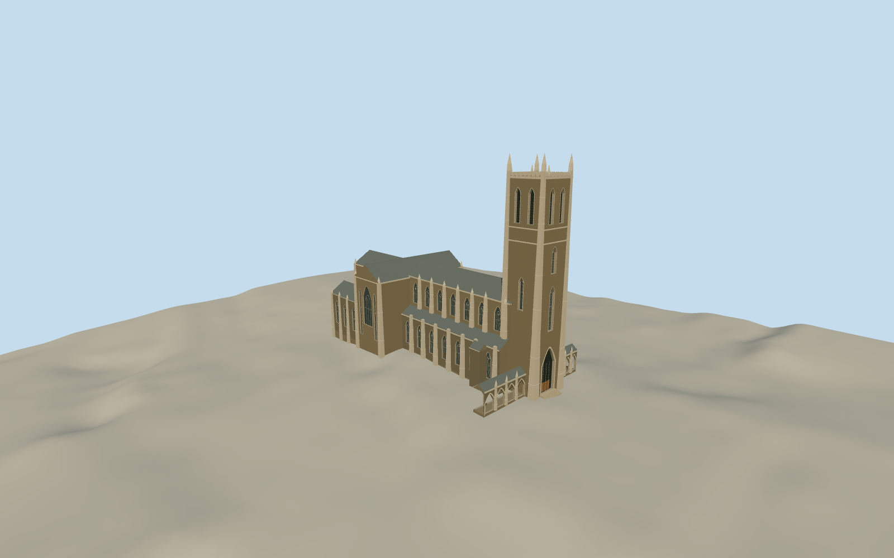

# Duke Chapel

English collegiate Gothic chapel with a tall pinnacled tower, cruciform body, traceried lancets and open cloister walks.

Authoring state: **review-in-qa.json**. Current completion evidence is in [qa.json](qa.json) and the [completion ledger](../../../../qualla-structures/batches/qualla-003.PROGRESS.md).

- [Duke Chapel](https://qualla.com/duke-chapel/)

The named mapped footprint, tower base and tower height control principal scale. Individual upper sections, roof pitches, window tracery and attached cloister lengths are reasonable approximations.

The four original 2019 photographs guide the tower, transept, Duke Stone and open cloister. Fine sculpture and stained-glass imagery are simplified.

The original independent terrain is unchanged. Approximate entrance and foundation grades reflect the local field. Separately mapped campus buildings and interiors are outside the chapel asset.

Build: `node content/worldgen/source/places/dn/dnr/duke_chapel/models/generate-duke-chapel.mjs`. Add `--check` to verify exact regeneration. 19928 triangles; 6 materials; no embedded photographs.
