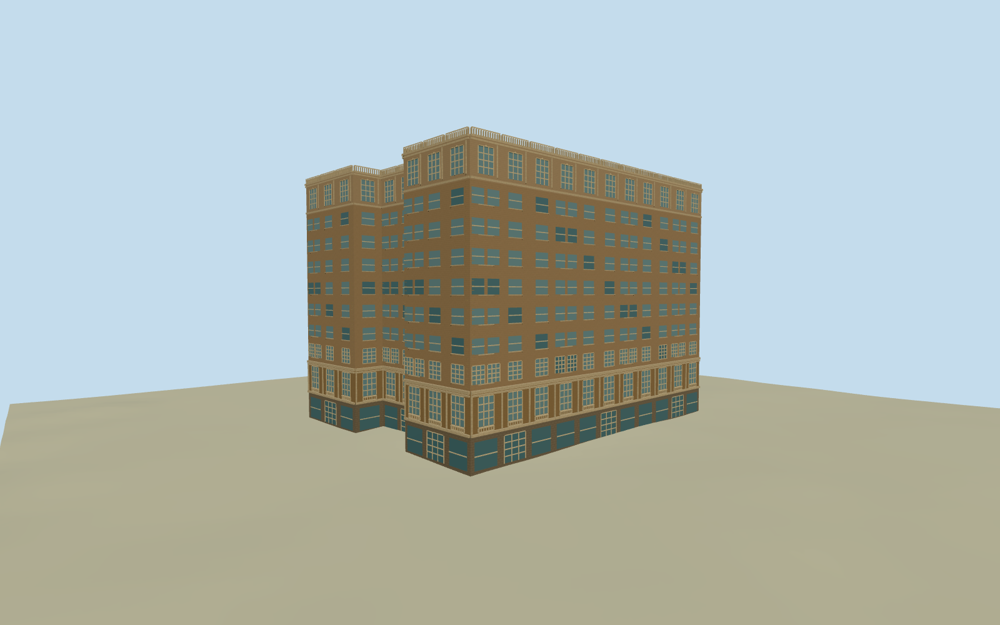

# Daniel Boone Hotel (Charleston, West Virginia)

The former Daniel Boone Hotel with a stepped buff-brick shaft, two-story retail base and terra-cotta roof balustrade.

Authoring state: **review-in-qa.json**. Current completion evidence is in [qa.json](qa.json) and the [completion ledger](../../../../qualla-structures/batches/qualla-004.PROGRESS.md).

- [Daniel Boone Hotel (Charleston, West Virginia)](https://qualla.com/daniel-boone-hotel-charleston-west-virginia/)

Source measurements of vertical section and rear wall details were unavailable. Heights, roof enclosure and fine terra-cotta profiles are estimated.

The exterior only, with no commercial sign faces, atrium furnishings or unrelated neighboring buildings.

Build: `node content/worldgen/source/places/dn/dnv/daniel_boone_hotel_charleston_west_virginia/models/generate-daniel-boone-hotel-charleston-west-virginia.mjs`. Add `--check` to verify exact regeneration. 20209 triangles; 5 materials; no embedded photographs.
