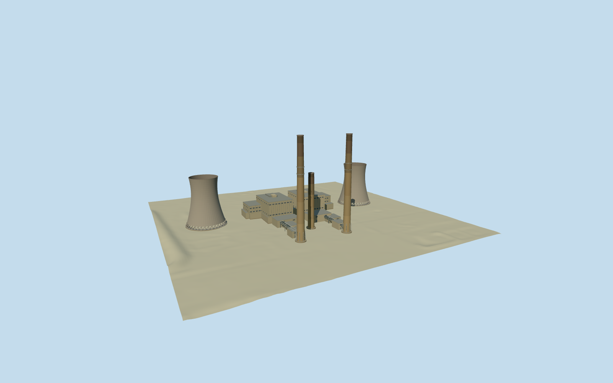

# Gavin Power Plant

Cheshire’s Gavin Power Plant with three chimneys, two open-rim cooling towers, and its generating hall.

Authoring state: **review-in-qa.json**. Current completion evidence is in [qa.json](qa.json) and the [completion ledger](../../../../qualla-structures/batches/qualla-004.PROGRESS.md).

- [Gavin Power Plant](https://qualla.com/gavin-power-plant/)

The two tall stacks use documented reference heights. Cooling-tower elevations, short stack height, steel framework and secondary hall geometry initially use photographic estimates.

Scope covers the above-ground plant silhouette and immediate exterior structures. Wider coal storage, switching yards and utilities are outside the model scope.

Build: `node content/worldgen/source/places/dn/dnv/gavin_power_plant/models/generate-gavin-power-plant.mjs`. Add `--check` to verify exact regeneration. 23750 triangles; 8 materials; no embedded photographs.
