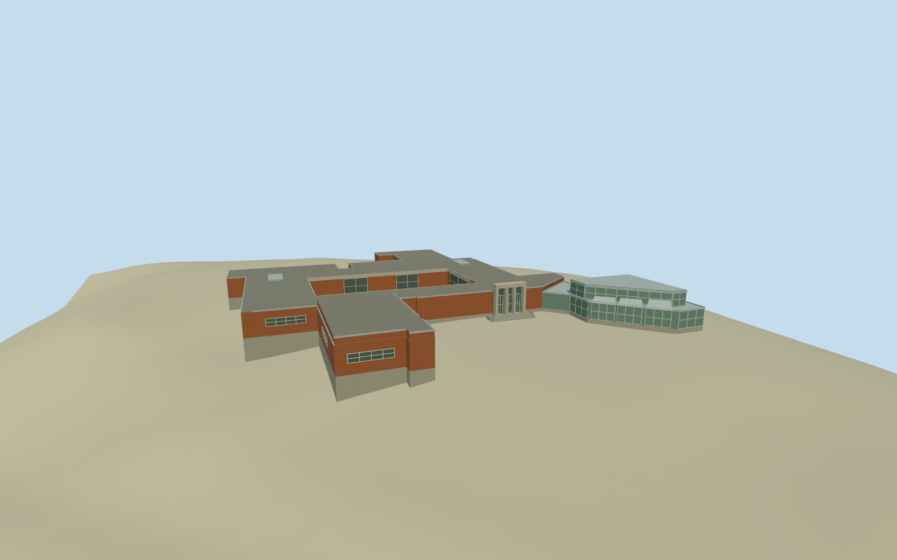

# Huntington Museum of Art

Huntington Museum of Art with low brick galleries, the stone entry portal and the glazed C. Fred Edwards Conservatory.

Authoring state: **review-in-qa.json**. Current completion evidence is in [qa.json](qa.json) and the [completion ledger](../../../../qualla-structures/batches/qualla-004.PROGRESS.md).

- [Huntington Museum of Art](https://qualla.com/huntington-museum-of-art/)

The mapped gallery envelope, open courtyard and connected conservatory are represented. Rear façade heights and openings are approximate.

The geometry focuses on the buildings and entry structure. Freestanding art and detached studios are outside scope.

Build: `node content/worldgen/source/places/dn/dnv/huntington_museum_of_art/models/generate-huntington-museum-of-art.mjs`. Add `--check` to verify exact regeneration. 4303 triangles; 7 materials; no embedded photographs.
