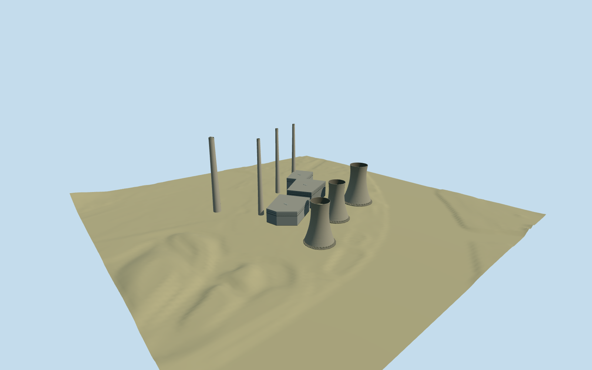

# John E. Amos Power Plant

The John E. Amos plant skyline with three waisted concrete cooling towers, slender stacks and grounded industrial roof masses.

Authoring state: **review-in-qa.json**. Current completion evidence is in [qa.json](qa.json) and the [completion ledger](../../../../qualla-structures/batches/qualla-003.PROGRESS.md).

- [John E. Amos Power Plant](https://qualla.com/john-e-amos-power-plant/)

The model depicts the dominant exterior skyline only. Roof polygons are approximate orthophoto readings with estimated eaves and roof top detail.

Cooling tower radius at grade follows the mapped circumference. Throat profile, wall colours, lower ribs, chimney details and proportions beyond published dimensions are approximate.

The model omits interior rooms, equipment, access infrastructure, minor ancillary buildings, steam, water and the wider industrial site.

Build: `node content/worldgen/source/places/dn/dnv/john_e_amos_power_plant/models/generate-john-e-amos-power-plant.mjs`. Add `--check` to verify exact regeneration. 18976 triangles; 5 materials; no embedded photographs.
