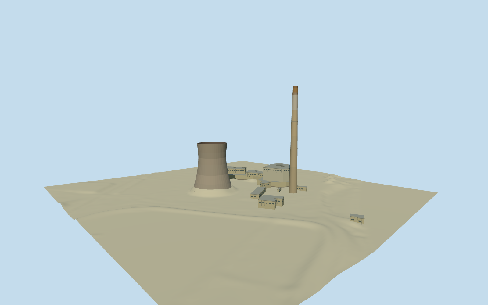

# Mountaineer Power Plant

Mountaineer Power Plant’s two tapered concrete chimneys, single hyperbolic cooling tower and generating hall along the Ohio River.

Authoring state: **review-in-qa.json**. Current completion evidence is in [qa.json](qa.json) and the [completion ledger](../../../../qualla-structures/batches/qualla-004.PROGRESS.md).

- [Mountaineer Power Plant](https://qualla.com/mountaineer-power-plant/)

The chimney and tower heights come from public agency records. Secondary elevations and the external details of the hall and cooling tower are approximated from the public footprint and records.

Scope covers the principal visible structures and immediate annexes. Plant interiors, broader utility infrastructure and offsite facilities lie outside this exterior model.

Build: `node content/worldgen/source/places/dn/dnv/mountaineer_power_plant/models/generate-mountaineer-power-plant.mjs`. Add `--check` to verify exact regeneration. 9764 triangles; 8 materials; no embedded photographs.
