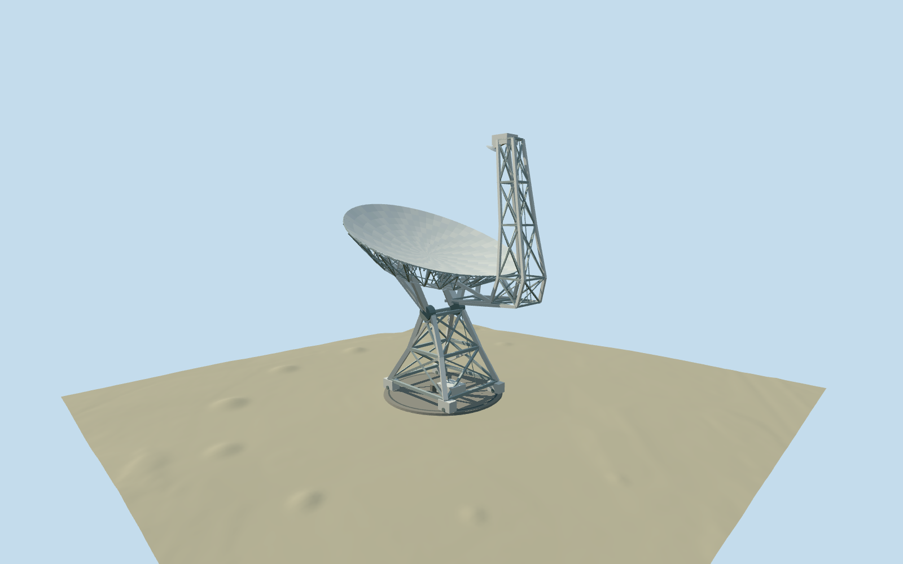

# Green Bank Telescope

Open steel radio telescope with a 100-by-110-metre asymmetrical dish, azimuth track, elevation axle and outboard feed tower.

Authoring state: **review-in-qa.json**. Current completion evidence is in [qa.json](qa.json) and the [completion ledger](../../../../qualla-structures/batches/qualla-004.PROGRESS.md).

- [Green Bank Telescope](https://qualla.com/green-bank-telescope/)

The telescope is a static high-elevation pose. The absolute azimuth and instantaneous observation target are representative.

The aperture span, base and axle are survey and specification based. Individual reflector panels, cabling, service equipment and connection details are represented at a coarser scale.

Build: `node content/worldgen/source/places/dn/dnz/green_bank_telescope/models/generate-green-bank-telescope.mjs`. Add `--check` to verify exact regeneration. 8050 triangles; 4 materials; no embedded photographs.
