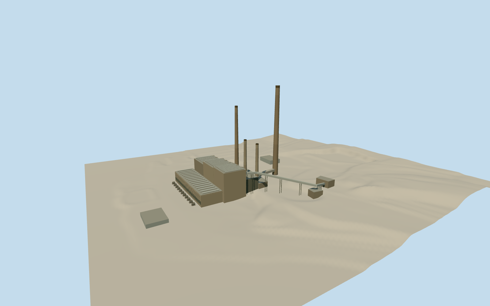

# Mount Storm Power Station

The generating buildings, coal conveyor and four stacks of Mount Storm Power Station on the west bank of the cooling lake in fall 2000.

Authoring state: **review-in-qa.json**. Current completion evidence is in [qa.json](qa.json) and the [completion ledger](../../../../qualla-structures/batches/qualla-003.PROGRESS.md).

- [Mount Storm Power Station](https://qualla.com/mount-storm-power-station/)

The exterior is dated to fall 2000. The scope covers the visible generating complex and attached conveyor approach, with the reservoir and open coal yard supplied by the surrounding scene.

The four stack positions use EPA or OpenStreetMap controls and only the two tallest stack heights are verified measurements. Short stack heights, attached machinery, elevations and cladding are approximate.

The USDA orthophoto is from 2007. It fixes the visible 2000-era generating campus in plan, with later exhaust equipment and full lake and stockyard infrastructure outside scope. Foundations are estimated from the original terrain without altering it.

Build: `node content/worldgen/source/places/dn/dnz/mount_storm_power_station/models/generate-mount-storm-power-station.mjs`. Add `--check` to verify exact regeneration. 6896 triangles; 5 materials; no embedded photographs.
