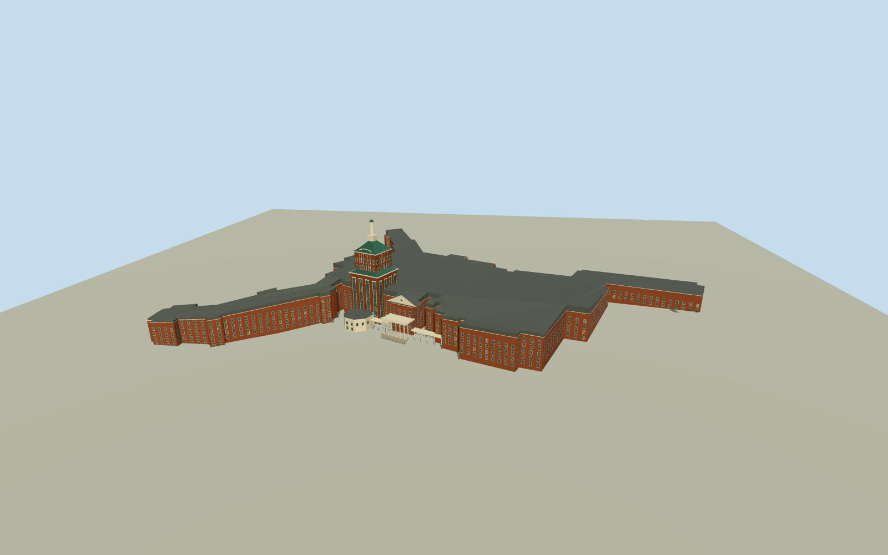

# The Omni Homestead Resort

The connected Homestead hotel, its Colonial Revival brick wings, white entrance colonnade and tiered 1929 clock tower.

Authoring state: **review-in-qa.json**. Current completion evidence is in [qa.json](qa.json) and the [completion ledger](../../../../qualla-structures/batches/qualla-003.PROGRESS.md).

- [The Omni Homestead Resort](https://qualla.com/the-omni-homestead-resort/)

Exterior of the connected hotel in 2021–2022, including its 1902 entrance block and 1929 tower. Detached resort facilities, vegetation, snow and interiors are outside model scope.

The landmark designation and photos constrain the major sections, color and front architectural details. Rear openings, roof junctions, terrace levels, wing elevations and fine sculpture are approximate.

An unmodified elevation field establishes the valley grade. The exact building floor datum and historical grade are not surveyed.

Build: `node content/worldgen/source/places/dn/dnz/omni_homestead_resort/models/generate-omni-homestead-resort.mjs`. Add `--check` to verify exact regeneration. 16246 triangles; 6 materials; no embedded photographs.
