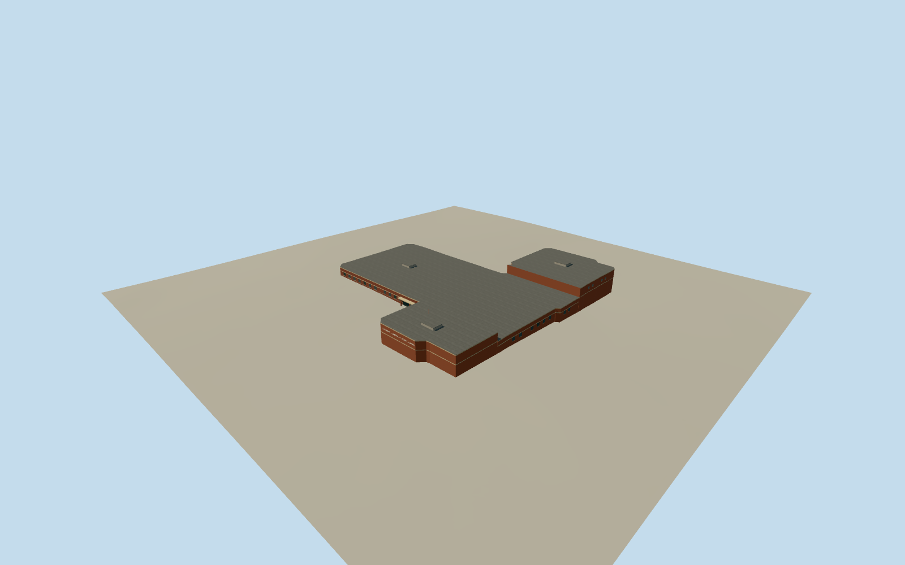

# Central Catholic High School, Bloomington

Bloomington’s red-brick Airport Road school with its pale belt courses, chamfered entrance range, recessed doors and tall gym.

Authoring state: **review-in-qa.json**. Current completion evidence is in [qa.json](qa.json) and the [completion ledger](../../../../qualla-structures/batches/qualla-003.PROGRESS.md).

- [Central Catholic High School (Bloomington, Illinois)](https://qualla.com/central-catholic-high-school-bloomington-illinois/)

The Airport Road school is represented in May 2015, with red brick, buff trim, the glazed entry and the connected classroom, gym and south ranges.

The mapped footprint fixes the combined envelope. Roof heights, service equipment, unseen elevations and the exact number of bays are estimates. The gym photograph informs the clerestory arrangement.

Original Terrarium samples are preserved. Historic paving and ground contact are approximate.

Build: `node content/worldgen/source/places/dp/dp0/central_catholic_high_school_bloomington_illinois/models/generate-bloomington-central-catholic.mjs`. Add `--check` to verify exact regeneration. 1403 triangles; 5 materials; no embedded photographs.
