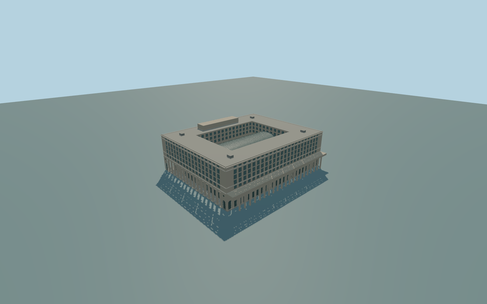

# Chicago Union Station

Whole individual above-ground Chicago Union Station historic headhouse and physically attached mapped Canal Street arcade/canopy. Preserve the separate underground concourse east of Canal, independent modern offices, public roads and surrounding buildings. Author all four exterior fronts and the actual roof/service masses after resolving the roof layout; no invented extra station platforms, copied lettering, advertising, people, trains or navigable interiors.

Rebuild: `node packages/worldgen/scripts/generate-chicago-union-station.mjs`;append `--check` for exact source bytes. Select import/LOD/placement with `--ids=chicago_union_station`. Detailed source and four browser tiers are separate ignored GLB outputs.

Whole individual above-ground Chicago Union Station historic headhouse and physically attached mapped Canal Street arcade/canopy. Preserve the separate underground concourse east of Canal, independent modern offices, public roads and surrounding buildings. Author all four exterior fronts and the actual roof/service masses after resolving the roof layout; no invented extra station platforms, copied lettering, advertising, people, trains or navigable interiors.

Retained exact-Q way/203442440 identifies Q1155989. The long axis is N/S: signed +X south toward Jackson Boulevard; -X north toward Adams Street; +Z west toward Clinton; -Z east toward Canal Street. Current PMTiles supplies the whole main building35184575531272 with height26m and attached long Canal strip35184815348058,layer1. The two ordinary street photographs show the Canal lower pilaster/door front and Jackson round-column colonnade, heavy entablature/friezes, arched corner entries, corner clocks, upper repeated rectangular windows/pilasters, narrow attic windows and a stepped rooftop service block. They do not establish the complete hidden roof/courtyard inventory; resolve that with an ordinary roof picture or available map geometry before authoring. Retained8levels and current native26m envelope are source controls, not surveyed facade/tower levels. Two additional ordinary rooftop photographs were inspected: a segmental barrel-vaulted Great Hall skylight is recessed inside four surrounding office wings. Model roof court x+-35,z+-25 and glass x+-33,z+-15 are picture-scale interpretations; hidden services and exact measured dimensions remain unverified. Use estimated exterior parapet35.2m,penthouse39m,skylight eaves21.5m/crest28.5m; native26m remains a conflicting coarse map control. One unchanged outside Jackson/Canal street reference[66,-55],179.7933694m absolute,sets Y=0. No bespoke surveys or archival research.

Historic above-ground headhouse only. Four ordinary street/roof pictures and current standard PMTiles; exact-Q way identifies the whole block. Native height26m and8levels are coarse source facts; parapet35.2m,penthouse39m,glass eaves21.5m/crest28.5m,upper-floor levels and roof-court dimensions are explicit picture-scale estimates. Hidden north/west bays and rooftop services are interpreted,not surveyed. Independent underground concourse,modern offices,roads,rail platforms and urban furniture remain separate. No lettering,emblems,ads,people,vehicles or navigable interiors. Physical-device/dense-city timing and numerical LOD errors remain unmeasured.

Five existing shared256px graphs:stone_limestone,concrete_plain,metal_standing_seam,metal_painted,window_grid. Five merged near material groups and one far palette group,metric UVs and linear colours,zero embedded/private images. Limestone walls/cornices,concrete bases,roof/service metal,painted skylight/window frames and actual glazing keep semantic slots. All four tiers preserve the whole headhouse,deep central roof court,continuous segmental barrel-vault skylight,four office-wing roofs,Canal projecting arcade,round-column end porticoes,corner entry piers and stepped rooftop service block. Near tiers add actual recessed/arched openings,clocks,window/roof framing,cornices,pilasters,attic windows and simplified dentils. Hidden facade inventory is explicitly interpreted.

Original geometry:repository license. Map:© OpenStreetMap contributors,ODbL-1.0;Protomaps. Standard terrain:terrain-grid.json. Ordinary pictures stay local and are not redistributed or used as textures. Current acceptance:qa.json.
