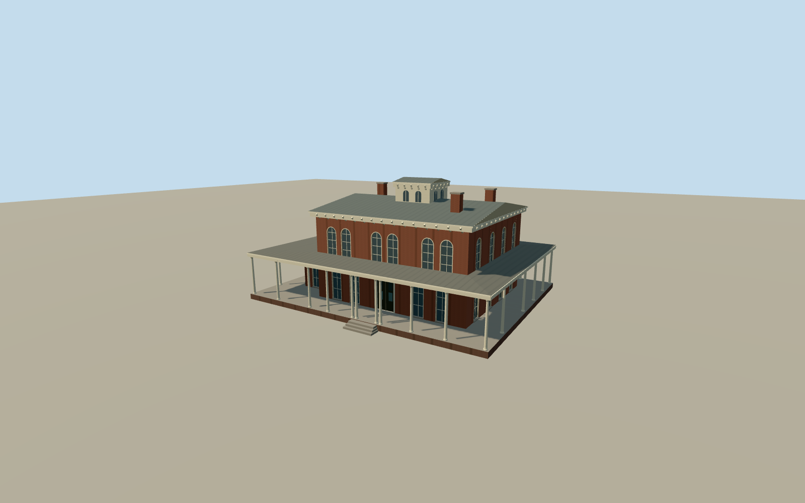

# Hull House, Chicago

The restored brick Italianate mansion with a pale wraparound veranda, arched windows, ornate eaves and rooftop cupola.

Authoring state: **review-in-qa.json**. Current completion evidence is in [qa.json](qa.json) and the [completion ledger](../../../../qualla-structures/batches/qualla-003.PROGRESS.md).

- [Hull House](https://qualla.com/hull-house/)

The model covers the original Hull mansion as restored and photographed in 2010. The separately mapped Residents’ Dining Hall is a separate building.

Survey dimensions control the principal volumes and windows. Roof, small trim details and rear elevation are interpreted from the available views and written survey.

The original public source terrain is unchanged. The entrance landing and ground registration are approximate.

Build: `node content/worldgen/source/places/dp/dp3/hull_house/models/generate-hull-house.mjs`. Add `--check` to verify exact regeneration. 12147 triangles; 6 materials; no embedded photographs.
