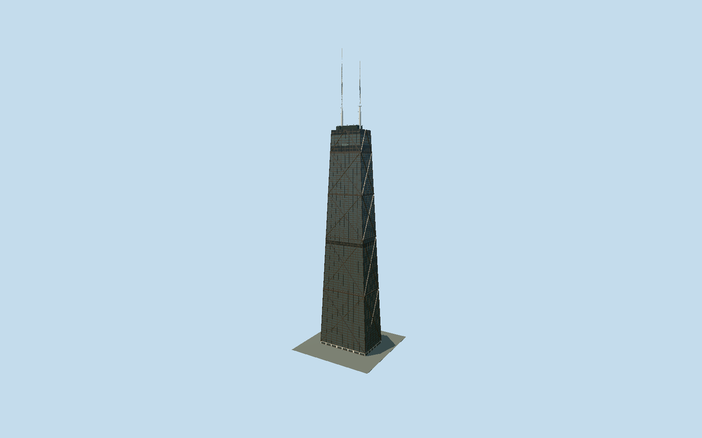

# 875 North Michigan Avenue

Chicago tapering dark bronze trussed tube, crossing lower diagonals and closed crown, pale retail base, mapped roof plant, unequal white-and-grey broadcast arrays and resting south TILT.

## Evidence and reconstruction

Published dimensions and reconstructed details are separated in spec.json. Primary references:

- [Reference](https://www.som.com/projects/875-north-michigan-avenue-formerly-john-hancock-center/)
- [Reference](https://www.bscesjournal.org/wp-content/uploads/CEP-Vol-19-No-2-02.pdf)
- [Reference](https://www.skyscrapercenter.com/building/john-hancock-center/345)
- [Reference](https://360chicago.com/articles/news-and-press/360-chicago-announces-the-debut-of-tilt)
- [Reference](https://www.openstreetmap.org/way/31064573)

No third-party geometry, photograph or bitmap texture is embedded. Shared surface graphs come from the central library; vertex tints carry model colors. Glazing uses PBR materials; transparent surfaces are declared per model.

## Model and axes

8,614 triangles; 18,458 vertices; 4 material groups; 770,684 bytes. Native bounds: -42.012, 0.000, -27.242 to 42.007, 456.904, 27.233. Source hash: `sha256:ea618eb614a170b48abc1825c9d6eebd15602665d1f0f63765fd936ef10b8cc5`.

{"up":"+Y","longitudinal":"+X east/slightly north","front":"+Z south/slightly east; TILT facade","origin":"Exact-QID mapped ground-contact footprint frame"}

The geographic proposal uses exact-QID OpenStreetMap evidence. Map-derived orientation and estimated architectural details require real-site visual review; preview eligibility is distinct from geographic/fidelity approval. Map attribution: © OpenStreetMap contributors, ODbL-1.0.

## Reproduce

Run `node packages/worldgen/scripts/generate-signature-towers.mjs --ids=N0171` (or add `--check`). The generator preserves manually edited masters by checking their baseline hashes. Import through the standard authored-model workflow with optimization disabled; then capture all QA cameras, including shared-surface views.

## Pending work

- Original 146050-triangle/17050792-byte detailed master remains reproducible from the unchanged global recipe. Reviewed source repairs the unsupported bottom-center V to crossing lower diagonals, adds the pale travertine retail surround, and replaces equally tall red-white solid poles with contemporary white mast bases and grey upper arrays at unequal heights seen in current SOM photos. Four-face taper, independent mapped penthouse and west/east antenna locations retained. Architectural top 343.7 m, highest tip 456.9 m and 100 floors from CVU; SOM 1127 ft/1970 differs from CVU 1969 completion. Main roof 1107 ft (337.4136 m), structural base 165x265 ft and roof 100x160 ft from Yasmin Sabina Khan engineering history. Office and residential floor stations, bracing tiers 4.15/92/176/242/304/337.1136 m, member thicknesses, east tip 435 m and platform equipment are reconstructed from photos, not surveyed. Four crossing tiers and the closed crown preserve the structural identity; exact joint heights are not asserted. Full facade planes and strip windows replace repeated panel frame geometry; distant strips aggregate coverage. Mast lattice is explicit at street/close levels and an opaque faceted grey aggregate at district/skyline. TILT is a static resting eight-pane assembly on the south facade; motion/interiors, sunken plaza, underground elements, exact door hardware, lettering/flags, small aerial equipment and unbuilt/future observation alterations excluded. Three canonical shared 256px concrete/travertine/painted-metal graphs, opaque palette glass and zero embedded images; no copied facade photograph. Terrain slope and physical device/dense-city performance unmeasured.

This bundle follows the medium-fi standard. Medium-fi appearance and geographic fit are reviewed separately. Hash-bound visual acceptance is recorded separately after capture inspection.
