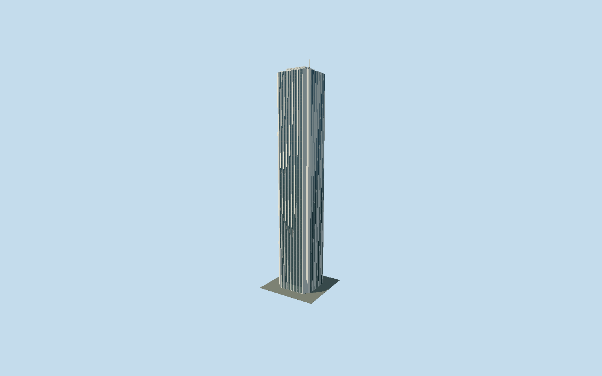

# Aon Center

Chicago white granite pinstriped tube with four notched solid corners, full-height V piers, tall glass lobby, mapped roof plant and current eastern broadcast mast.

## Evidence and reconstruction

Published dimensions and reconstructed details are separated in spec.json. Primary references:

- [Reference](https://www.skyscrapercenter.com/chicago/aon-center/339)
- [Reference](https://www.architecture.org/online-resources/buildings-of-chicago/aon-center)
- [Reference](https://www.aoncenter.info/toc.cfm)
- [Reference](https://www.openstreetmap.org/way/64388609)

No third-party geometry, photograph or bitmap texture is embedded. Shared surface graphs come from the central library; vertex tints carry model colors. Glazing uses PBR materials; transparent surfaces are declared per model.

## Model and axes

2,310 triangles; 5,902 vertices; 4 material groups; 242,980 bytes. Native bounds: -30.505, 0.000, -30.054 to 30.505, 362.500, 30.054. Source hash: `sha256:ce857e47a6f0ec1b42809a9b55abc8246ab3ef925f4164956192f1c195dde5d9`.

{"up":"+Y","longitudinal":"+X south/slightly east","front":"+X south Randolph lobby; +Z west/slightly south","origin":"Exact-QID mapped ground-contact footprint frame"}

The geographic proposal uses exact-QID OpenStreetMap evidence. Map-derived orientation and estimated architectural details require real-site visual review; preview eligibility is distinct from geographic/fidelity approval. Map attribution: © OpenStreetMap contributors, ODbL-1.0.

## Reproduce

Run `node packages/worldgen/scripts/generate-signature-towers.mjs --ids=N0172` (or add `--check`). The generator preserves manually edited masters by checking their baseline hashes. Import through the standard authored-model workflow with optimization disabled; then capture all QA cameras, including shared-surface views.

## Pending work

- Original 168138-triangle/17479792-byte master remains exactly reproducible from the unchanged global recipe. Reviewed source keeps the signed notched tower and separate roof plant, corrects the corner returns to broad solid granite surfaces, retains full-height V-faced granite piers down through the tall lobby and adds the photo-supported eastern roof antenna to published362.5 m tip. Published architectural346.3 m/occupied328 m/83floors/1973/recladding1992 from CVU. Main roof340 m, lobby10.4 m,15bays per long face, pier half-width.69 m/depth.58 m, glazing/floor pitch,8 m south/12 m east antenna offset, antenna diameter/supports and service forms are reconstructed, not measured construction dimensions. Full vertical glass planes and long frame/spandrel strips replace per-window frame geometry; distant levels aggregate horizontal coverage. Stone grain uses canonical shared granite; no tiny joint geometry or copied facade photo. Three shared256px concrete/granite/painted-metal graphs and opaque palette glass, zero embedded images. Two-level landscaped sunken plaza, fountains/sculptures, subterranean garage/pedways, lobby interiors, detailed doors, flags/lettering, minor rooftop aerials and proposed observation-deck/elevator alterations excluded. Ground-contact shell has no terrain-grade proof. Physical phones/laptops and dense-city timing remain unmeasured. Cached Los Angeles Aon photos/brochure explicitly rejected; they do not inform this model.

This bundle follows the medium-fi standard. Medium-fi appearance and geographic fit are reviewed separately. Hash-bound visual acceptance is recorded separately after capture inspection.
