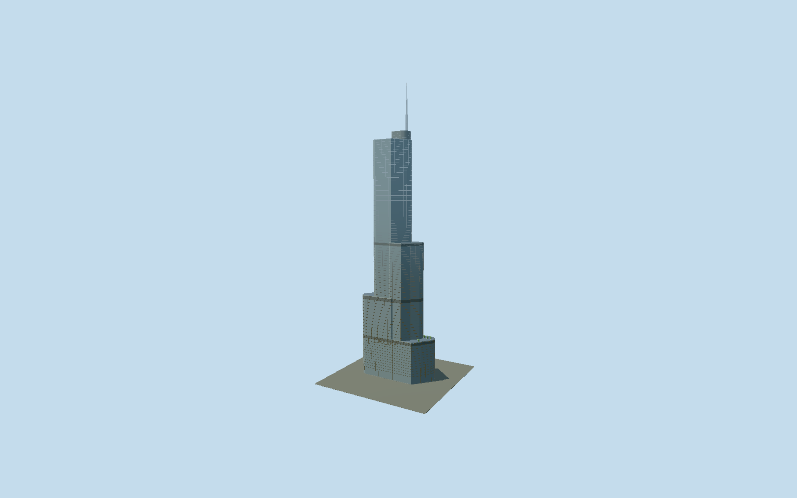

# Trump International Hotel and Tower Chicago

Chicago riverfront tower with four rounded glass volumes, asymmetric terraces, stainless bands, mapped ornamental spire and river-facing lettering.

## Evidence and reconstruction

Published dimensions and reconstructed details are separated in spec.json. Primary references:

- [Reference](https://www.smithgill.com/work/trump_international_hote/)
- [Reference](https://www.skyscrapercenter.com/building/building/203)
- [Reference](https://store.ctbuh.org/PDF_Previews/Journal/CTBUHJournal_2009-3.pdf)
- [Reference](https://alpolic-americas.com/blog/alpolic-used-on-high-rise-high-profile-hotel-in-chicago-by-som/)
- [Reference](https://www.spiderstaging.com/casestudies/sign-installation-trump-international-hotel-tower/)
- [Reference](https://www.openstreetmap.org/way/64594680)

No third-party geometry, photograph or bitmap texture is embedded. Shared surface graphs come from the central library; vertex tints carry model colors. Glazing uses PBR materials; transparent surfaces are declared per model.

## Model and axes

9,885 triangles; 26,737 vertices; 4 material groups; 1,084,016 bytes. Native bounds: -55.508, 0.000, -21.744 to 54.337, 423.200, 21.830. Source hash: `sha256:c992f25955b339dc8a1dc9dc59c21d07856a8eeef787187aee7faf9d018055aa`.

{"up":"+Y","longitudinal":"+X northeast","front":"+Z southeast riverfront","origin":"Ground-level center of signed mapped footprint at the tower entrance datum"}

The geographic proposal uses exact-QID OpenStreetMap evidence. Map-derived orientation and estimated architectural details require real-site visual review; preview eligibility is distinct from geographic/fidelity approval. Map attribution: © OpenStreetMap contributors, ODbL-1.0.

## Reproduce

Run `node packages/worldgen/scripts/generate-signature-towers.mjs --ids=N0174` (or add `--check`). The generator preserves manually edited masters by checking their baseline hashes. Import through the standard authored-model workflow with optimization disabled; then capture all QA cameras, including shared-surface views.

## Pending work

- Original 80651-triangle, 7471112-byte detailed master remains exactly reproducible from the unchanged global recipe. Reviewed source and four browser levels retain four rounded asymmetric mapped volumes, three setbacks, pale stainless floor bands, tall offset crown and a three-section 423.2 m spire. Near levels retain the reconstructed Wabash canopy, terrace rails/selected planting and original geometric serif sign. Distant levels aggregate floor/column coverage and terrace detail; skyline keeps a sign band instead of legible letters. Continuous glazing plus long strips replace per-cell frames, and the canopy uses thin opaque upper/lower daylight glazing faces. Intermediate stage heights are approximate map data, not surveyed sections; marketed 92 floors differ from current CVU 98, while occupied height 340.1 m and architectural/tip height 423.2 m agree. Crown/antenna radii derive from the mapped parts; panel rhythm, canopy ribs/curvature, serif stroke widths, planting and exact sign elevation are reconstructed. The 140 ft sign span follows its installer. Three shared 256 px concrete, stainless and granite graphs; no embedded images or copied photographic textures. Riverwalk descending terraces, underground/double-helix parking ramp, interiors, exact entrance thresholds and terrain slope remain outside the tower-shell asset. No terrain-grade or physical phone/laptop performance claim.

This bundle follows the medium-fi standard. Medium-fi appearance and geographic fit are reviewed separately. Hash-bound visual acceptance is recorded separately after capture inspection.
