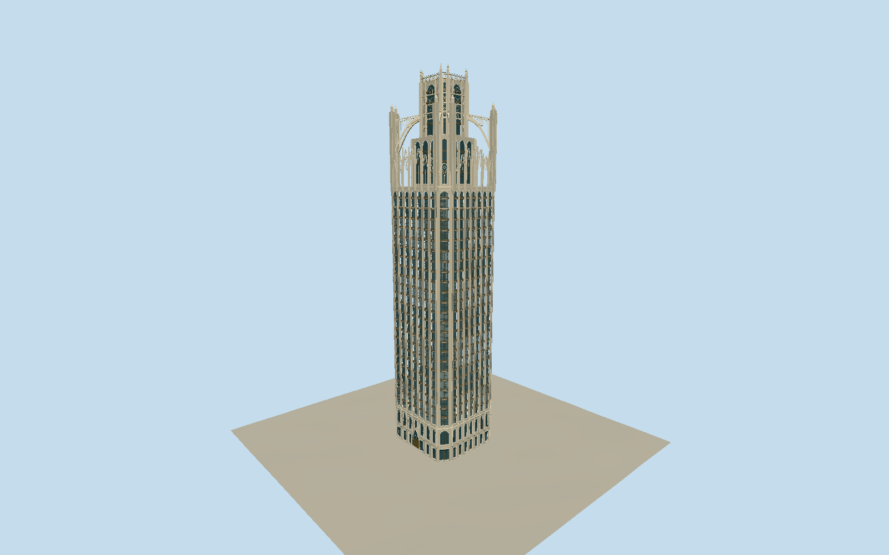

# Tribune Tower

Historic Chicago TribuneTower: own native chamfered eight-sided shaft with Indiana limestone raised vertical piers, individually divided recessed glazing/dark horizontal spandrels, elaborate lower Gothic lights/inset bronze doors and pointed west mainportal, original simplified foliate relief/embedded historic fragment patches. Stepped inward central Gothic crown with round-arched glazed lights, eight independent outer buttress piers/actual curved open flying spans/pierced tracery and galleries/clustered ribs/crocketed pinnacles/small abstract gargoyles. Flat upper cap/metal guard/flagpole, no invented spire. Historic tower only; Radio/TV/printingplant/newglasswings/courtyard/newTribuneEast/neighbors/statue/interiors excluded.

Authoring state: **review-in-qa.json**. Current completion evidence is in [qa.json](qa.json) and the [local 100 ledger](../../../../qualla-structures/batches/PROGRESS.md).

- [Tribune Tower](https://qualla.com/tribune-tower/)

Historic tower exterior interpreted from2007–2013details and2021conversion aerial; restoredfacade corroboratedbyconversionarchitect. No claim of surveyed2026condition.

Native chamfered tower outline/141mapheight and141.7marchitectural/145.8mtipCTBUH controls. Intermediatefloor/terrace/crown/window/rail/ornamentdimensions proportionalestimates; Qualla462ft/native141m differfromdatabase141.7m.

Historic toweronly. Exclude distinctRadio/TV/printingplant/recentglassadditions/elevatedcourtyard/pool/newTribuneEasttower, Wrigley/InterContinental/neighbors/plaza/statue/trees/streetfixtures/interiors. No invented central Gothicspire.

Original simplifiedGothictracery/animal-likegargoyle/foliatepanel and embeddedfragmentpatches; no literal sculpturalreplicas/inscriptions/signage/photo textures or completefragmentinventory. Flagpole retained, time-varyingflagcloth/antennas omitted.

Independentground acquiredbeforegeometry unchanged; publicurbanDEM/nativeground/datumandthresholdengineering remain approximate andhostdependent. Footprintreplacement disabled.

Build: `node packages/worldgen/scripts/generate-authored-places.mjs --ids=tribune_tower`. Add `--check` to verify exact regeneration. 59462 triangles; 5 materials; no embedded photographs.
