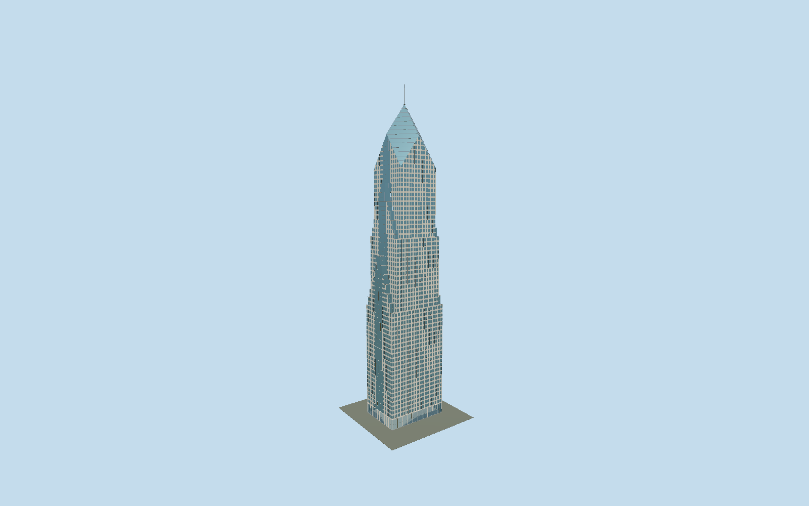

# Two Prudential Plaza

Pale granite tower with blue recessed vision bays, continuous glazed central north/south strips, chevron setbacks and a diamond crown with slender spire; tall glazed Stetson lobby with reconstructed revolving doors.

## Evidence and reconstruction

Published dimensions and reconstructed details are separated in spec.json. Primary references:

- [Reference](https://www.theprulife.com/wp-content/uploads/2021/06/OTP_Large-Block-Plans_All-28-30.pdf)
- [Reference](https://www.theprulife.com/wp-content/uploads/2024/04/Pru_FilmingScoutBrochure_April2024.pdf)
- [Reference](https://www.skyscrapercenter.com/chicago/two-prudential-plaza/489)
- [Reference](https://mchughconcrete.com/projects/two-prudential-plaza/)
- [Reference](https://www.linkedin.com/posts/turner-construction-company_builtbyturner-turnerchicago-onetwopru-activity-7333884834496356371-FkpT)
- [Reference](https://commons.wikimedia.org/wiki/File:Two_Prudential_Plaza_Chicago_in_May_2016.jpg)
- [Reference](https://commons.wikimedia.org/wiki/File:Two_Prudential_Plaza_-_Exterior_1_(7883111728).jpg)
- [Reference](https://www.openstreetmap.org/way/64388666)

No third-party geometry, photograph or bitmap texture is embedded. Shared surface graphs come from the central library; vertex tints carry model colors. Glazing uses PBR materials; transparent surfaces are declared per model.

## Model and axes

52,004 triangles; 111,704 vertices; 6 material groups; 4,649,048 bytes. Native bounds: -28.235, 0.000, -21.445 to 28.235, 303.300, 20.576. Source hash: `sha256:c85bd1ad1556ec7647d576b6a077f35b509105ca9687ecc8c9f7ee40a61e9bfe`.

{"up":"+Y","longitudinal":"+X south along the long mapped axis","front":"-Z east toward Stetson","origin":"Cached tower envelope center at provisional local pavement contact"}

The geographic proposal uses exact-QID OpenStreetMap evidence. Map-derived orientation and estimated architectural details require real-site visual review; preview eligibility is distinct from geographic/fidelity approval. Map attribution: © OpenStreetMap contributors, ODbL-1.0.

## Reproduce

Run `node packages/worldgen/scripts/generate-signature-towers.mjs --ids=two_prudential_plaza` (or add `--check`). The generator preserves manually edited masters by checking their baseline hashes. Import through the standard authored-model workflow with optimization disabled; then capture all QA cameras, including shared-surface views.

## Pending work

- The unchanged twoPrudentialPlazaStudy.encodeAssembly reproduces the original fourteen-part instanced source master, preserved in its unchanged original recipe and local review artifact. Reviewed source and close-up retain the original granite/glass facade modules, chevron setbacks, terrace caps, clipped diamond crown and 80 ft spire, with two reconstructed revolving entrance drums replacing the four provisional swing doors and whole rectangular lobby piers replacing facade-only strips. Owner photos show revolving doors; exact counts, offsets and rotor angle are not surveyed. Street replaces masonry bay pieces with flat full wall faces and blue panes 0.14 m forward of the original reveal plane; the floor/window rhythm, central glazed end strips and every chevron step remain. District merges up to three facade rows/bays, always splitting at actual plan changes, and omits door detail; skyline averages granite/window area colors while retaining principal glazed end strips, every setback cap, diamond roof and spire. Near levels retain fifteen crown stripes; far omits roof ribs. Four shared graphs supply granite, stainless, painted metal and concrete; opaque/clear glass produces six near groups with one transparent group. No copied photo textures. Joint arrises and fine glazing divisions are omitted by the preserved original recipe despite older maximum-fidelity wording. 63 photographic office rows, 3.875 m intervals, shoulder heights and slope 1.4 are working reconstructions, not floor surveys; registry 64 floors is separate, and the contractor page has conflicting 60/68 counts. The wider One/Two Pru plaza, fountain, sculpture, shared connector, rooftop garden and neighboring tower are excluded from this tower asset. Owner upper-floor plans are undimensioned and not a complete ground survey; local grade and internal floors are approximate. Physical laptop/phone and dense-city timings remain pending.

This bundle follows the medium-fi standard. Medium-fi appearance and geographic fit are reviewed separately. Hash-bound visual acceptance is recorded separately after capture inspection.
