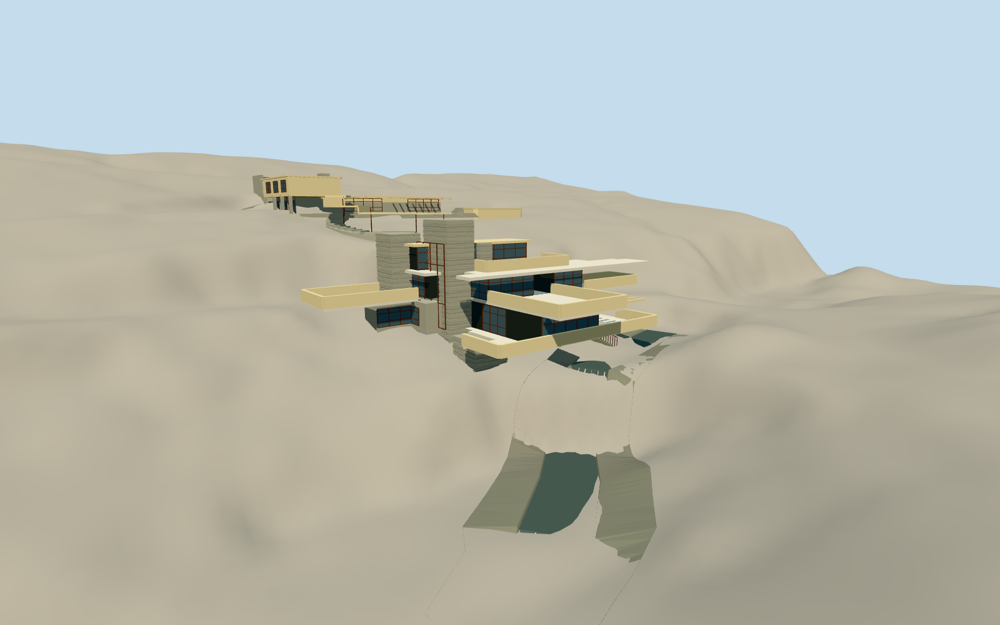

# Fallingwater

Crossed buff concrete cantilevers, stratified sandstone core, red window frames and hanging stream stair above Bear Run, with an uphill guest wing and covered curved connection.

Authoring state: **review-in-qa.json**. Current completion evidence is in [qa.json](qa.json) and the [local 100 ledger](../../../../qualla-structures/batches/PROGRESS.md).

- [Fallingwater](https://qualla.com/fallingwater/)

Original medium-fi exterior starts with cleared public-domain Qualla photographs and original public-domain HABS PA-5346/PA-5346-A site, floor, elevation and section drawings. Main-house occupied rooms, open terraces, floor heights and east-west stream stair replace earlier generalized assumptions. Raster tracing, core partitions and geographic registration remain interpreted; bounded exterior acceptance is recorded in qa.json. Old copied plan and miniature images are excluded.

Crossing terrace axes, stone core, red glazing, hanging stair and clear underside are modeled. Exact room plans, hidden facades, guest-wing openings, structural repairs and roof drains are simplified interpretations.

The static stream, shaped rock channel and two cascades illustrate the house-waterfall relationship. Separate bounded openings follow physical rock cuts and solid guest-house floors, retaining ground between the structures. The narrow cleft under the upper-hall bridge has a modeled rock bottom. These are not a hydrologic simulation, exact geological reconstruction or current water-level claim. Native terrain values are preserved.

The north upper-floor bridge and curved exterior stair are distinct from the first-floor entrance. Guest floor +10.3314 m is an interpreted threshold above independent ground, not a combined-site floor survey. Original HABS floor/site topology and relative levels control the geometry; manually traced plan proportions are not georeferenced CAD. Physical cuts, exposed car-court apron, stone stair bodies and retaining walls represent the excavated architecture. Apron width, short approach and geological surfaces are interpreted exterior geometry.

No interior furnishings, sculpture replica, surrounding forest or external image textures are included. Local reference photography remains outside runtime packs.

Build: `node packages/worldgen/scripts/generate-authored-places.mjs --ids=fallingwater`. Add `--check` to verify exact regeneration. 43142 triangles; 5 materials; no embedded photographs.
