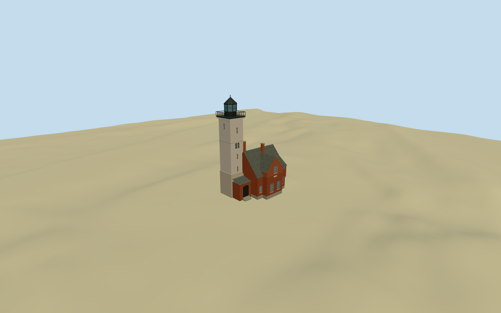

# Presque Isle Lighthouse

Presque Isle’s square white lighthouse with its octagonal lantern, iron gallery, red brick keeper’s residence and summer kitchen.

Authoring state: **review-in-qa.json**. Current completion evidence is in [qa.json](qa.json) and the [completion ledger](../../../../qualla-structures/batches/qualla-003.PROGRESS.md).

- [The Presque Isle Lighthouse and the Lake Erie Mysteries](https://qualla.com/presque-isle-lighthouse/)

The square tower and attached cottage are measured massings based on the native outline and three HABS plates. Select details are simplified. Colors derive from the published external descriptions.

The full tower height to finial is an approximate scaled reading of the two-part HABS elevation, while the Coast Guard lists the light at 73 feet above the lake. The keeper’s house follows the standing mapped outline.

The modeled scene includes the beacon exterior and the keeper’s residence. Nearby visitor buildings and the former boathouse are outside scope.

Build: `node content/worldgen/source/places/dp/dpr/presque_isle_lighthouse/models/generate-presque-isle-lighthouse.mjs`. Add `--check` to verify exact regeneration. 2567 triangles; 5 materials; no embedded photographs.
