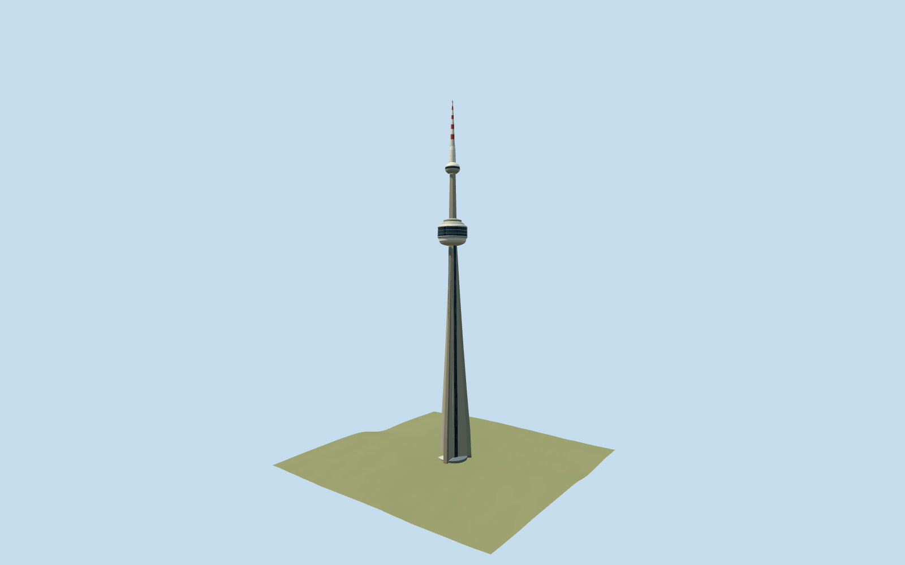

# CN Tower, Toronto

Geographically fitted concrete CN Tower with three swept buttresses, stacked observation decks and segmented broadcast mast.

Authoring state: **review-in-qa.json**. Current completion evidence is in [qa.json](qa.json) and the [completion ledger](../../../../qualla-structures/batches/qualla-003.PROGRESS.md).

- [Toronto CN Tower: The Needle That Defined a Skyline](https://qualla.com/toronto-cn-tower/)
- [CN Tower: The Communications Tower That Became a City's Symbol](https://qualla.com/cn-tower-toronto/)

This replaces the provisional tower asset in its existing catalog location and covers the tower itself; the aquarium, adjacent SkyWalk, stadia, and interiors are outside scope.

Current plan geometry and the tower operator’s elevations govern the major forms. The exact shape of the transitions, glazing subdivision, plinth details and communications equipment are estimated.

Ground elevation is an unmodified Terrarium sample; individual thresholds and the elevation of the surrounding paved plaza are approximate.

Build: `node content/worldgen/source/places/dp/dpz/b07_cn_tower_toronto/models/generate-b07-cn-tower-toronto.mjs`. Add `--check` to verify exact regeneration. 7153 triangles; 6 materials; no embedded photographs.
