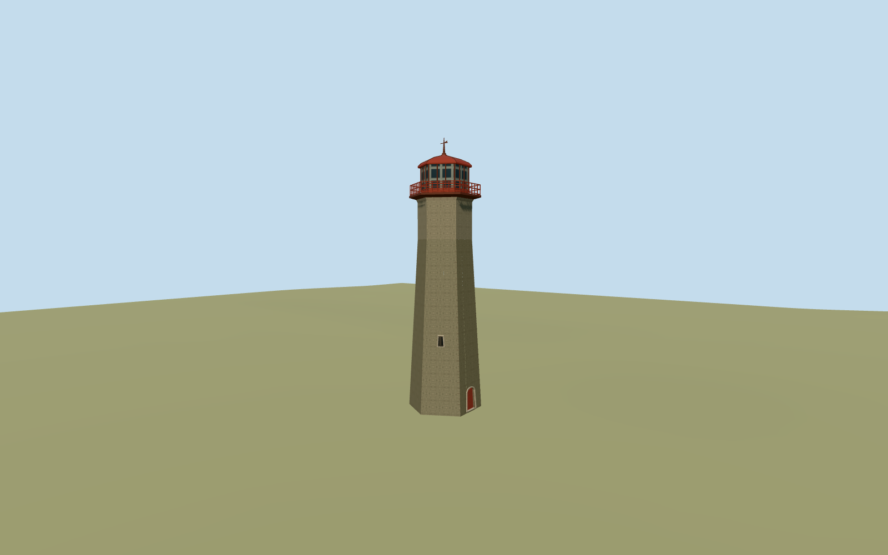

# Gibraltar Point Lighthouse

Gibraltar Point Lighthouse as it stands on the Toronto Islands, with tapered six-sided Queenston stone, an open red gallery, glazed lantern, shaped metal cap and vane.

Authoring state: **review-in-qa.json**. Current completion evidence is in [qa.json](qa.json) and the [completion ledger](../../../../qualla-structures/batches/qualla-003.PROGRESS.md).

- [Gibraltar Point Lighthouse: Toronto's Oldest Cold Case](https://qualla.com/gibraltar-point-lighthouse/)

Lantern glazing, sill details, exact masonry courses, and opening positions on partly hidden faces are interpreted from the 2011 photograph and documented construction.

The historic 1815 lantern, keeper’s house, surrounding woods, paths, plaques and later park improvements are outside the model.

Build: `node content/worldgen/source/places/dp/dpz/gibraltar_point_lighthouse/models/generate-gibraltar-point-lighthouse.mjs`. Add `--check` to verify exact regeneration. 2799 triangles; 6 materials; no embedded photographs.
