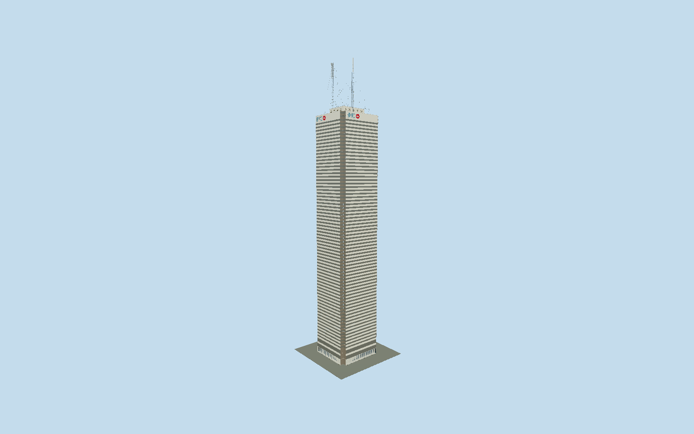

# First Canadian Place

First Canadian Place after the 2012 recladding: rectangular notched plan, individually jointed white fritted-glass spandrels, bronze corner returns, paired vision lights, recessed colonnade, BMO crown panels and three detailed rooftop masts.

## Evidence and reconstruction

Published dimensions and reconstructed details are separated in spec.json. Primary references:

- [Reference](https://www.mdeas.com/first-canadian-place)
- [Reference](https://bharchitects.com/en/project/first-canadian-place-recladding/)
- [Reference](https://www.bharchitects.com/wp-content/uploads/2017/08/The-Second-Life-of-Tall-Bldgs-ENGLISH.pdf)
- [Reference](https://axiistenantapp.com/wp-content/uploads/2024/12/FCP-Building-Specs-2022.pdf)
- [Reference](https://gizmostorageprod.blob.core.windows.net/files/B2B%20Property%20Detail%20Page%20Files/First%20Canadian%20Place%20Web%20Final%20July%202021%20w%20Floor%20Plans.pdf)
- [Reference](https://buildingscience.com/sites/default/files/0103_First_Canadian_Place.pdf)
- [Reference](https://www.skyscrapercenter.com/building/wd/543)
- [Reference](https://necrat.us/fcp.html)
- [Reference](https://www.openstreetmap.org/way/27767627)

No third-party geometry, photograph or bitmap texture is embedded. Shared surface graphs come from the central library; vertex tints carry model colors. Glazing uses PBR materials; transparent surfaces are declared per model.

## Model and axes

27,876 triangles; 52,620 vertices; 10 material groups; 1,975,096 bytes. Native bounds: -29.778, 0.000, -28.254 to 29.778, 355.000, 28.254. Source hash: `sha256:ff389af9eecd5a5c9bc9ce3a75c3c2dce0a265a09e31960207baabda5725c77b`.

{"up":"+Y","longitudinal":"+X east-northeast along the longer map axis","front":"+Z south-southeast","origin":"Cached tower footprint center at local ground contact; broader retail complex not yet registered."}

The geographic proposal uses exact-QID OpenStreetMap evidence. Map-derived orientation and estimated architectural details require real-site visual review; preview eligibility is distinct from geographic/fidelity approval. Map attribution: © OpenStreetMap contributors, ODbL-1.0.

## Reproduce

Run `node packages/worldgen/scripts/generate-signature-towers.mjs --ids=N0227` (or add `--check`). The generator preserves manually edited masters by checking their baseline hashes. Import through the standard authored-model workflow with optimization disabled; then capture all QA cameras, including shared-surface views.

## Pending work

- The unchanged four-part GPU-instanced firstCanadianPlaceStudy.encodeAssembly remains the detailed source master. Runtime close-up reproduces all original geometry while combining opaque vision, bronze and backing surfaces into one tinted glass group. Six canonical graphs remain distinct for white fritted glass, stainless steel, painted metal, concrete, granite paving and marble lobby walls; with opaque and 52 percent clear palette glass this deliberately uses eight near groups, preserving visibly different architectural finishes rather than duplicating bitmaps. The preserved master has ten groups. Street retains every original office stripe and BMO vector mark, with a simpler recessed glazed lobby, whole piers and six-sided bollards; roof lattice stages, antennas and plant louvres are reduced. District retains each office stripe and all four corner steps, with sparse piers, closed mast envelopes and the round emblem in place of small wordmark strokes. Skyline merges five floor intervals into broad white/vision bands with the same area ratio; texture means are baked into one palette draw and small details are omitted. All levels retain the closed notched slab, crown, plant enclosure and three distinct masts. Owner modules, reconstructed 289.9 m body parapet, 298.1 m plant top, 355 m north tip and 351 m reconstructed south tip remain distinct. Average office spacing extrapolates floor datums; it does not survey every slab or confirm the allocation of marketed floor labels. Facade panel counts differ across publications, and the 50 mm triangular frit pitch is inferred. Exact door inventory, roof aerial layout and approximate BMO lettering are reconstructions. The model extent is the tower and its recessed colonnade within the mapped tower envelope; the broader retail/Exchange Tower complex is a separate site model and is excluded. Public raw adjacent outlines do not establish a surveyed retail boundary. Grade is approximate and no footprint replacement is used. Physical device and dense-city timing measurements remain pending.

This bundle follows the medium-fi standard. Medium-fi appearance and geographic fit are reviewed separately. Hash-bound visual acceptance is recorded separately after capture inspection.
