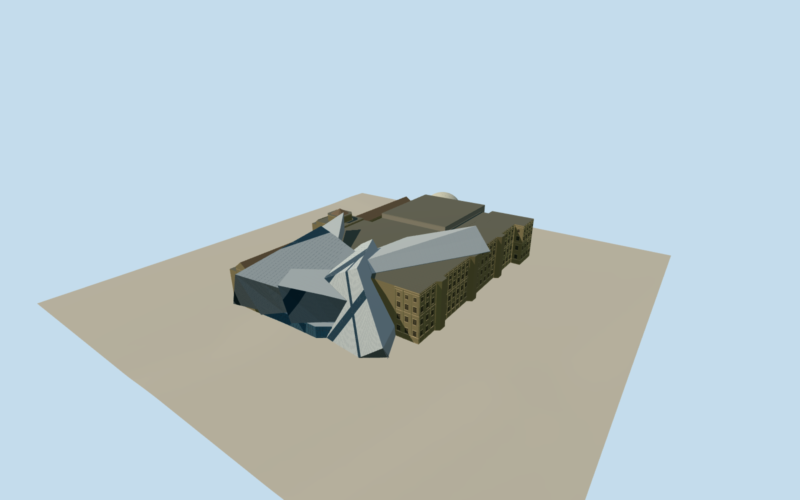

# Royal Ontario Museum

Toronto’s Royal Ontario Museum in 2015 with the sloping aluminum and glass Crystal, the two limestone wings, Queen’s Park entrance and the former planetarium.

Authoring state: **review-in-qa.json**. Current completion evidence is in [qa.json](qa.json) and the [completion ledger](../../../../qualla-structures/batches/qualla-003.PROGRESS.md).

- [Royal Ontario Museum: Where Dinosaurs Meet Deconstructivism](https://qualla.com/royal-ontario-museum/)

The model depicts the 2015 museum complex, including the former planetarium. It predates later plaza changes and demolition of the planetarium.

The mapped outlines, heights and roof bearings control the masses. Some cantilever angles, glazed facet seams, fenestration and unphotographed elevations are estimates.

The original terrain remains unchanged. The building and pavement contacts use approximate local elevations.

Build: `node content/worldgen/source/places/dp/dpz/royal_ontario_museum/models/generate-royal-ontario-museum.mjs`. Add `--check` to verify exact regeneration. 28639 triangles; 6 materials; no embedded photographs.
