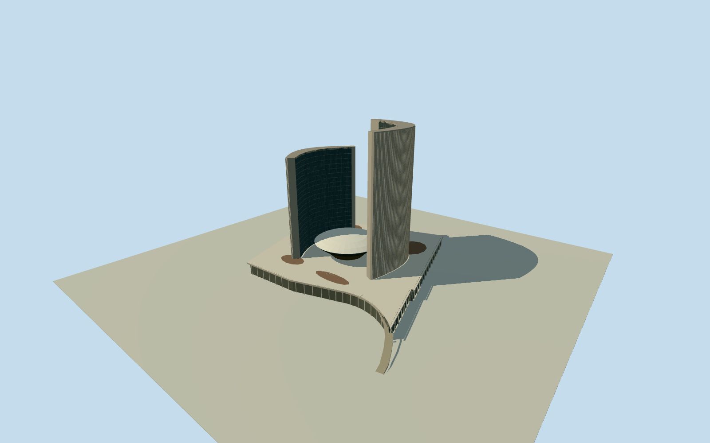

# Toronto City Hall

Two concrete and glass crescents rise over Toronto City Hall’s low circular council chamber, civic podium and ceremonial ramp.

Authoring state: **review-in-qa.json**. Current completion evidence is in [qa.json](qa.json) and the [completion ledger](../../../../qualla-structures/batches/qualla-003.PROGRESS.md).

- [Toronto City Hall: The Building That Was Almost Thrown Away](https://qualla.com/toronto-city-hall/)

The model represents the April 2018 City Hall exterior with the two curved tower slabs, podium, council chamber and ceremonial ramp. The wider square and adjacent structures are outside scope.

The footprint and 79.4 and 99.5 metre roof heights follow the named map record. Council chamber construction and roof profile, the podium’s paving and garden details, and the exact ceremonial ramp section remain approximate.

The original regional elevation model provides the surrounding ground. It does not resolve the podium floor, plaza paving or individual thresholds.

Build: `node content/worldgen/source/places/dp/dpz/toronto_city_hall/models/generate-toronto-city-hall.mjs`. Add `--check` to verify exact regeneration. 6515 triangles; 6 materials; no embedded photographs.
