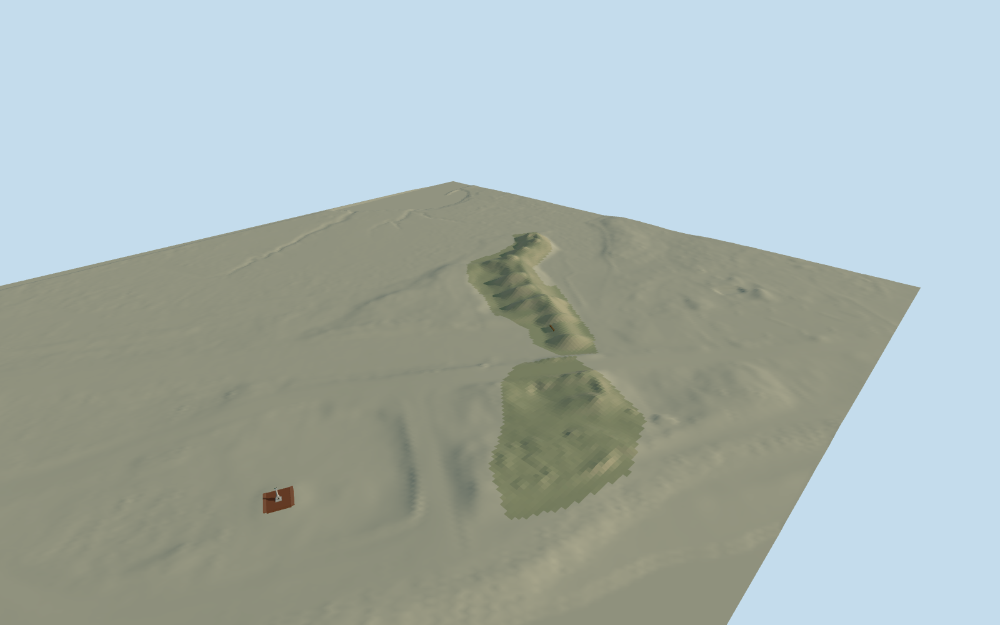

# Fort Fisher

The surviving and restored land-face earthworks of Fort Fisher, with the ocean-side fragment and the Battle Acre Monument.

Authoring state: **review-in-qa.json**. Current completion evidence is in [qa.json](qa.json) and the [completion ledger](../../../../qualla-structures/batches/qualla-004.PROGRESS.md).

- [Fort Fisher](https://qualla.com/fort-fisher/)

The 2025 aerial constrains the restored land face in plan. Heights of the post-2020 restoration and fine monument sculpture are approximate.

Build: `node content/worldgen/source/places/dq/dq0/fort_fisher/models/generate-fort-fisher.mjs`. Add `--check` to verify exact regeneration. 9240 triangles; 5 materials; no embedded photographs.
