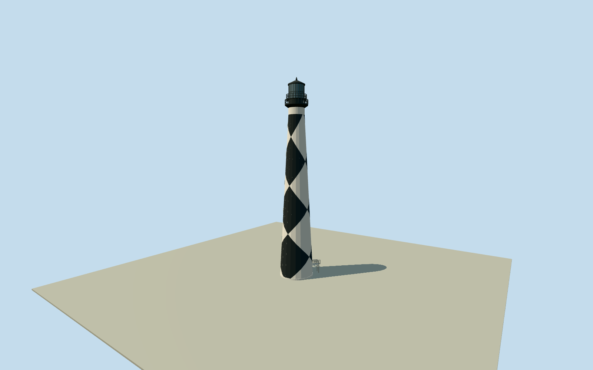

# Cape Lookout Lighthouse

Complete49.6844m1859Cape Lookout tower at its actual native location: mapped tapered round masonry, original black/white diamond daymark in true cardinal alignment, white neck/flared dark galleries/watch stage/open rails, glazed lantern/dark roof/vent/finial, shallow divided windows/doors and native northeast entrance steps/open landing. Exact public-domain NPSstaff original first inspected through Qualla then byte-matched to primary federal release. Separate houses/1812ruin/site/boardwalk/temporary restoration works excluded. Minor sections/paint phase/windows/rails and coastal contact approximate.

Authoring state: **review-in-qa.json**. Current completion evidence is in [qa.json](qa.json) and the [completion ledger](../../../../qualla-structures/batches/qualla-002.PROGRESS.md).

- [Cape Lookout Lighthouse](https://qualla.com/cape-lookout-lighthouse/)

Exact named lighthouseway727525529/Q4286379and intrinsic entrance stepsway991715350fix tower identity/circular footprint, cardinal frame and northeast entrance/approach. This tower is about2.2kmfrom the story coordinate, which lies farther down the cape; actual named native plan controls model placement. Native height15.7m conflicts with its own seamark51.5m and official NPS163ftaboveground/169ftASL; use independently documented163ft=49.6844moverall height, retaining the full conflicting native tags as evidence. Original approximate8.5mplan versus official8.7122mbase diameter is a mapping/survey difference, not reason to stretch terrain. Minor vertical subdivisions and hidden details are explicit architectural estimates.

Qualla first: exact published3072x2048NPSstaff image inspected; pinned primary NPGallery record explicitly credits National Park Service staff and public domain. Selected primary original is byte-identical to Qualla image, avoiding missing category provenance in generated Qualla metadata. Both shareSHA256b81ab7aa34a69d8275e20f4c92e2284ec5c5c75562bae94ec23137c67e86750c. No additional architectural photo, generatedbitmap or copied photographic texture.

Official NPS163ftabove-ground/49.6844moverall height and4.0386mtop diameter govern vertical scale. Original approximate8.5mnative base circle retained; published8.7122mbase diameter differs slightly. Native15.7mheight is explicitly inconsistent and excluded; seamark51.5mhas a different measurement datum. Minor profile/roof/gallery levels are independent estimates from inspected photograph rather than a measured restoration survey.

Black diamond centers face true north/south and white centers east/west. Rhombi are original clipped vertex-color geometry retained in all four LODs, with photograph-informed approximate12mpitch/vertical phase. No camera-facing rotation or copied daymark photograph. Small window distribution/white watch-room aperture/door sizes and rail/pane census are representative; concealed interiors and optical apparatus are excluded.

Surviving permanent tower only; NPSarchive metadata2004does not establish camera date. Native current northeast stair/landing controls approach geometry. Detached keeper house/visitor center/1812tower ruins, grounds/wholeboardwalk/vegetation/beach, and temporary2025-2026conservation/scaffolding/site works excluded. No proposed1859attached house reconstructed. Closed blue-grey glazing approximates panes; lighthouse emits no simulated navigational signal.

Independent160mrawTerrariumfield frozen before geometry at actual native entrance stair bottom. Original source grid/tiles/PNGpreserved without flattening/fitting. Sandy coastal threshold/footings and host contact approximate; no model terrain/platform. Flatstage is illustrative rather than surveyed grade.

Build: `node packages/worldgen/scripts/generate-authored-places.mjs --ids=cape_lookout_lighthouse`. Add `--check` to verify exact regeneration. 4358 triangles; 3 materials; no embedded photographs.
